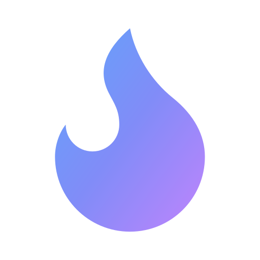
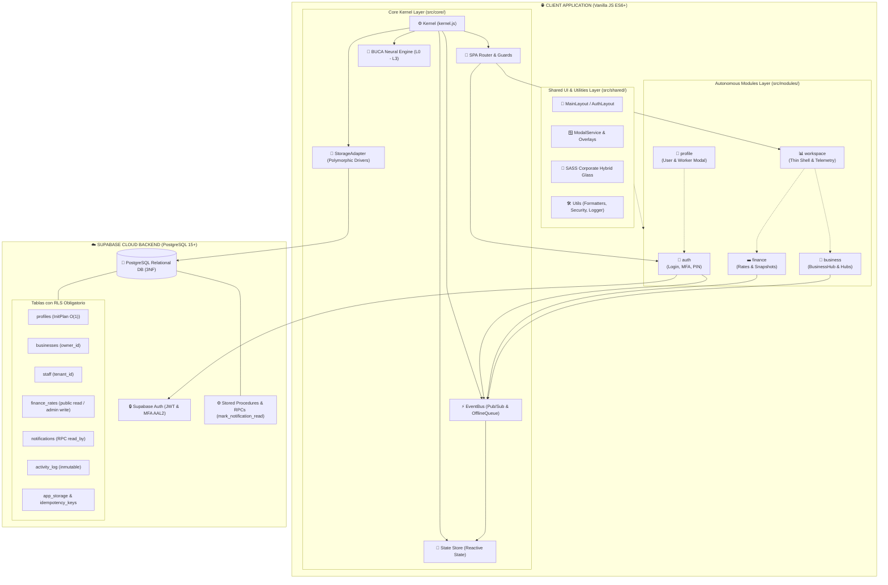

<p align="center">
  
</p>

<h1 align="center">B.U.C.A. AI</h1>
<h3 align="center">Business Under Control Access — Enterprise Anti-Crisis Modular ERP</h3>

<p align="center">
  Plataforma empresarial de alto rendimiento diseñada con arquitectura <strong>Clean Core en Vanilla JavaScript modular (ES6+)</strong>, motor gráfico adaptativo <strong>Buca Neural Engine (BNE)</strong> y persistencia relacional aislada multi-inquilino sobre <strong>Supabase (PostgreSQL)</strong>.
</p>

<p align="center">
  <a href="https://github.com"></a>
  <a href="https://developer.mozilla.org/es/docs/Web/JavaScript"></a>
  <a href="https://vitejs.dev"></a>
  <a href="https://supabase.com"></a>
  <a href="https://sass-lang.com"></a>
  <a href="LICENSE"></a>
</p>

---

## 📌 Visión y Propósito

**B.U.C.A. AI** es una Single Page Application (SPA) modular y progresiva concebida para operaciones de comercio, inventario y finanzas en contextos económicos volátiles y de alta exigencia de hardware. Combina una interfaz gráfica de última generación (*Corporate Hybrid Glass*) con una política estricta de **cero dependencias de frameworks externos (React, Vue, Angular o JSX)**, garantizando tiempos de carga casi instantáneos, bajo consumo de memoria RAM y ejecución a 60 FPS estables incluso en dispositivos con recursos limitados.

---

## 🚀 Capacidades y Características Principales

### 1. Clean Core Architecture (3-Tier Layered Design)
- **Capa Kernel (`src/core/`)**: Orquestación procedural de arranque, despachador de eventos pub/sub reactivo, enrutador SPA nativo basado en History API, guardias de seguridad, detección de hardware y gestión de temas.
- **Capa de Módulos Autónomos (`src/modules/`)**: Dominios desacoplados que operan bajo demanda (`auth`, `workspace`, `business`, `finance`, `profile`).
- **Capa de Recursos Compartidos (`src/shared/`)**: Layouts estructurales (`MainLayout`, `AuthLayout`), modales globales, componentes de cabecera flotante, diseño modular en SASS y utilidades transversales.

### 2. BUCA Neural Engine (BNE v5.3.0)
- Motor de adaptación gráfica en tiempo real que previene el estrangulamiento de GPU (*layout thrashing* y *GPU throttling*).
- **Monitores Continuos**: Telemetría de FPS, termalismo (`ThermalGuard`) y consumo de memoria (`MemoryGuard`).
- **Perfiles Dinámicos de Degradación**:
  - `L0 Eco`: Desactiva desenfoques (`backdrop-filter`) y sombras, aplicando fondos sólidos optimizados para hardware integrado y ahorro de batería.
  - `L1 Balanced`: Desenfoques suaves, animaciones estándar y optimización de renderizado.
  - `L2 Pro`: Estética completa *Corporate Hybrid Glass*, efectos bloom moderados y transiciones fluidas.
  - `L3 Ultra`: Efectos visuales máximos, reflejos dinámicos, partículas y trazabilidad de alta densidad.

### 3. Control Financiero Multi-Moneda y Snapshot Pattern
- Gestión de cotizaciones en tiempo real e interoperabilidad multi-divisa: **USD, VES (BCV y Paralelo), EUR y USDT**.
- **Cálculo Automático de Brecha Cambiaria**: Supervisión porcentual del diferencial cambiario para proteger márgenes comerciales contra devaluaciones imprevistas.
- **Patrón Snapshot Inmutable**: Las transacciones y cotizaciones históricas se anclan en el tiempo; ninguna orden consulta cotizaciones volátiles en tiempo real.

### 4. Seguridad Perimetral, RBAC y Aislamiento Multi-Tenant
- **PostgreSQL Row Level Security (RLS)**: Cada consulta a la base de datos es evaluada a nivel de fila por políticas `InitPlan O(1)` utilizando `(SELECT auth.uid())` y `owner_id`.
- **Control de Acceso Basado en Roles (RBAC)**: Matriz dual que distingue entre roles de plataforma (`super_admin`, `admin`, `user`) y roles de negocio dentro del comercio (`owner`, `manager`, `worker`).
- **Autenticación Multifactorial (MFA / TOTP RFC 6238)**: Integración segura con desafío AAL2, renderizado QR en Canvas 2D nativo sin librerías externas y generación de 8 claves de recuperación de emergencia formateadas (`BUCA-XXXX-XXXX`).

### 5. Drive Pattern (Persistencia Polimórfica Resiliente)
- Abstracción transparente de almacenamiento a través de `StorageAdapter.js`:
  - **Memory Driver**: Operaciones volátiles ultra-rápidas en memoria RAM.
  - **Local Driver**: Claves cifradas en `localStorage` para preferencias cosméticas.
  - **IndexedDB Driver**: Almacenamiento local persistente con soporte para operaciones offline y TTL estructurado.
  - **Supabase Driver**: Sincronización remota en la nube bajo la tabla particionada `app_storage` y `idempotency_keys`.

---

## 🏛️ Diagrama de Arquitectura del Sistema

El siguiente diagrama ilustra el flujo de comunicación, el ciclo de vida y la interacción entre el núcleo del sistema, los canales de eventos reactivos, los módulos funcionales y el backend remoto:



---

## 💻 Requisitos del Entorno

- **Node.js**: `>= 20.0.0` (LTS recomendado).
- **Gestor de Paquetes**: `npm` `>= 10.0.0`.
- **Navegadores Soportados**: Chrome 110+, Edge 110+, Firefox 115+, Safari 16.4+ (requiere soporte nativo para ES Modules, Web Crypto API y CSS Custom Properties).

---

## ⚡ Instalación y Puesta en Marcha (Quick Start)

### 1. Clonar el Repositorio
```bash
git clone https://github.com/tu-organizacion/buca-ai.git
cd buca-ai
```

### 2. Instalar Dependencias
```bash
npm install
```

### 3. Configuración de Variables de Entorno
Crea un archivo local `.env.local` basado en la plantilla de ejemplo `.env.example`:

```bash
cp .env.example .env.local
```

Configura las variables maestras de Supabase:
```env
VITE_SUPABASE_URL=https://tu-proyecto.supabase.co
VITE_SUPABASE_ANON_KEY=tu-anon-key-de-supabase
```

### 4. Ejecución en Modo Desarrollo
Inicia el servidor local de Vite con Hot Module Replacement (HMR):
```bash
npm run dev
```
La aplicación estará disponible de inmediato en `http://localhost:3000`.

### 5. Validación de Calidad y Pruebas
Ejecuta la suite de pruebas unitarias y de integración del sistema:
```bash
# Ejecutar tests de seguridad, RLS, MFA y sincronización offline
npm test

# Verificación de sintaxis y código limpio
npm run lint

# Verificación de tipado estricto
npm run type-check
```

### 6. Compilación para Producción
Genera el paquete optimizado de distribución en la carpeta `/dist`:
```bash
npm run build
```

---

## 📚 Documentación Técnica Detallada

Para consultar las especificaciones técnicas completas de arquitectura, modelos de base de datos y motores internos, consulta el índice maestro en la carpeta `docs/`:

- [📑 Índice Maestro de Documentación](docs/README.md)
- [🏗️ Arquitectura de Software y Ciclo de Vida](docs/architecture.md)
- [🐘 Especificación de Base de Datos PostgreSQL y RLS](docs/database.md)
- [🎨 Motor Gráfico BUCA Neural Engine (BNE)](docs/engine.md)
- [🧩 Guía de Desarrollo de Módulos Plug-and-Play](docs/modules-guide.md)
- [📖 Glosario Corporativo y Conceptual](docs/glossary.md)

---

## 🤝 Contribución y Gobernanza

Este repositorio sigue directivas de arquitectura no negociables: **cero frameworks externos**, convención de nomenclatura `kebab-case`, límite estricto de **300 líneas de código por archivo** y flujo de trabajo mediante ramas en "Y".

Antes de enviar cualquier cambio o abrir un Pull Request, lee atentamente el archivo [CONTRIBUTING.md](CONTRIBUTING.md).

---

## 🛡️ Seguridad y Divulgación Responsable

La seguridad de las transacciones y los datos multi-inquilino es una prioridad crítica. Si identificas una vulnerabilidad potencial, por favor sigue el protocolo establecido en [SECURITY.md](SECURITY.md).

---

## 📄 Licencia

Este proyecto está protegido bajo una licencia corporativa propietaria para el ecosistema **B.U.C.A. AI**. Todos los derechos reservados.
