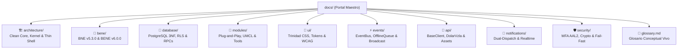

# 📑 Portal Maestro de Documentación de Ingeniería — B.U.C.A. AI
## Sistema Documental Enterprise Modular y Versionado por Dominios

> **Ecosistema:** B.U.C.A. AI (Business Under Control Access)  
> **Versión de la Plataforma:** `v1.1.8-alpha` (Producción) | `v6.0.0` (Investigación BENE)  
> **Stack:** Vanilla JS Modular (ES6+), SASS Embedded, Vite 8, Supabase (PostgreSQL 15+ con RLS)  
> **Gobernanza:** Clean Core, Cero Frameworks Externos, Límite de 300 Líneas por Archivo

Bienvenido al repositorio maestro de ingeniería de **B.U.C.A. AI**. La documentación se encuentra estrictamente organizada por directorios de dominio, incorporando las especificaciones de producción actuales y la hoja de ruta de innovación técnica `(new)`.

---

## 🧭 Mapa de Dominios de Ingeniería

---

## 📚 Índice de Dominios Técnicos

| Dominio | Directorio | Descripción y Temas Clave | Estado |
|---|---|---|:---:|
| **Arquitectura Core** | [architecture/](file:///c:/wamp64/www/Clepces/projects/buca-ai/docs/architecture/README.md) | Clean Core de 3 capas, bootloader de `BucaKernel`, `ModuleLoader` resiliente y patrón `Workspace Thin Shell`. | `[v1.1.8]` `[Roadmap]` |
| **Motor Gráfico BENE**| [bene/](file:///c:/wamp64/www/Clepces/projects/buca-ai/docs/bene/README.md) | Motor Neuronal de Efecto Equilibrado. Núcleo v5.3.0 (`L0-L3`) y arquitectura v6.0.0 (orquestador agnóstico de efectos `bne-*`). | `[v5.3]` `[v6.0]` |
| **Persistencia Relacional** | [database/](file:///c:/wamp64/www/Clepces/projects/buca-ai/docs/database/README.md) | PostgreSQL 15+ sobre Supabase, políticas RLS O(1) InitPlan, RPCs `SECURITY DEFINER` y tabla `idempotency_keys`. | `[v1.1.8]` |
| **Ecosistema Modular** | [modules/](file:///c:/wamp64/www/Clepces/projects/buca-ai/docs/modules/README.md) | Catálogo de módulos, ciclo de vida `UMCL` de 5 fases (`load-file` a `load-clear`), herramientas globales vs modulares y roadmap (`pos`, `ai-copilot`). | `[v1.1.8]` `[new]` |
| **Sistema de Diseño Visual** | [ui/](file:///c:/wamp64/www/Clepces/projects/buca-ai/docs/ui/README.md) | La Trinidad Visual BENE (Base Sólida + Capa de Efectos + Adaptabilidad Cromática), tokens SCSS, Z-Index y WCAG AAA. | `[v1.1.8]` `[new]` |
| **Bus de Eventos y Cola** | [events/](file:///c:/wamp64/www/Clepces/projects/buca-ai/docs/events/README.md) | Pub/Sub desacoplado con comodines, despacho transaccional `emitTransactional`, `OfflineReplayQueue` y sincronización multi-pestaña `BroadcastChannel`. | `[v1.1.8]` `[new]` |
| **Conectividad y APIs**| [api/](file:///c:/wamp64/www/Clepces/projects/buca-ai/docs/api/README.md) | `BaseClient` con timeouts e interceptores, feed de divisas DolarVzla (BCV/Paralelo), cálculo de brecha % y capturas técnicas en `assets/`. | `[v1.1.8]` |
| **Notificaciones Dual** | [notifications/](file:///c:/wamp64/www/Clepces/projects/buca-ai/docs/notifications/README.md) | Patrón Dual-Dispatch (HUD visual reactivo + tabla persistente `public.notifications`), canales Realtime y Web Push. | `[v1.1.8]` `[new]` |
| **Seguridad y Cripto** | [security/](file:///c:/wamp64/www/Clepces/projects/buca-ai/docs/security/README.md) | Enrolamiento MFA AAL2 (TOTP RFC 6238), QR nativo en Canvas 2D, claves de respaldo `BUCA-XXXX-XXXX` y `CryptoWrapper`. | `[v1.1.8]` |
| **Glosario Conceptual** | [glossary.md](file:///c:/wamp64/www/Clepces/projects/buca-ai/docs/glossary.md) | Diccionario canónico vivo de terminología propia: *Drive Pattern*, *Snapshot Pattern*, *BENE*, *UMCL*, *Trinidad Visual*, *Fail-Open Guard*. | `[Vivo]` |

---

## 🏛️ Gobernanza y Referencias de Raíz

* [🤝 Guía de Contribución y Commits (CONTRIBUTING.md)](file:///c:/wamp64/www/Clepces/projects/buca-ai/CONTRIBUTING.md)
* [🛡️ Política de Seguridad y Divulgación Responsable (SECURITY.md)](file:///c:/wamp64/www/Clepces/projects/buca-ai/SECURITY.md)
* [📋 Registro Histórico de Versiones (CHANGELOG.md)](file:///c:/wamp64/www/Clepces/projects/buca-ai/CHANGELOG.md)
* [🚨 Directivas de Agentes Autónomos (AGENTS.md)](file:///c:/wamp64/www/Clepces/projects/buca-ai/AGENTS.md)
