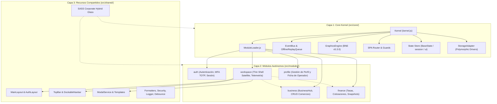
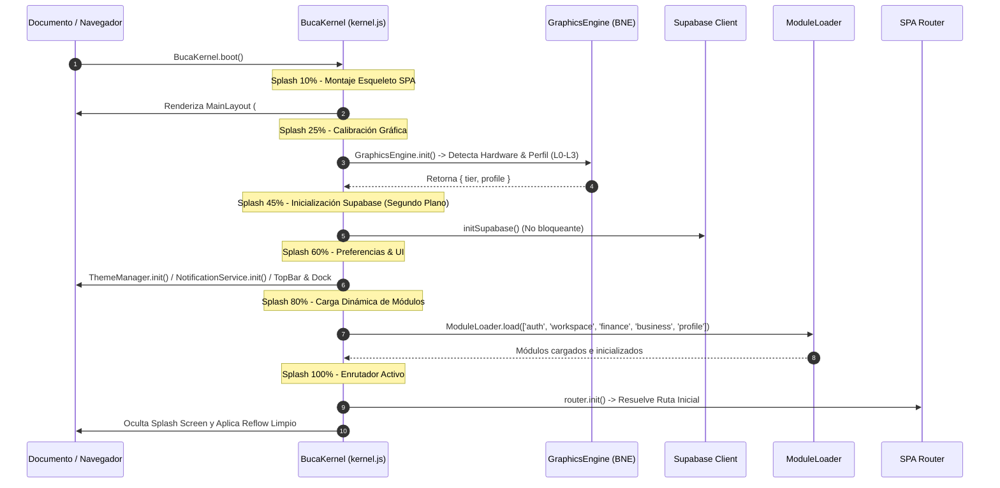

# 🏗️ Arquitectura de Software y Ciclo de Vida del Kernel — B.U.C.A. AI

> **Documento:** Especificación Arquitectónica, Ciclo de Vida del Kernel, ModuleLoader y Thin Shell  
> **Patrón:** Clean Core Layered Design (3 Capas) en Vanilla JavaScript Modular (ES6+)  
> **Filosofía:** Cero Frameworks, Alto Rendimiento a 60 FPS, Aislamiento Modular y Resiliencia Anti-Crisis

---

## 1. Patrón Arquitectónico Clean Core (3 Capas)

B.U.C.A. AI desacopla rigurosamente sus responsabilidades en tres capas arquitectónicas concéntricas para garantizar mantenibilidad a largo plazo sin dependencias de frameworks externos:

```text
src/
├── core/       ── Capa 1: Kernel, Motores de Bajo Nivel, Router, Estado y Servicios Centrales
├── modules/    ── Capa 2: Dominios de Negocio Autónomos y Desacoplados (Plug-and-Play)
└── shared/     ── Capa 3: Layouts Estructurales, Modales, Estilos SASS y Utilidades Reutilizables
```



---

## 2. Ciclo de Vida y Arranque Procedural del Kernel (`BucaKernel`)

El arranque de la plataforma es orquestado por la clase `BucaKernel` en `src/core/kernel.js`. El proceso sigue un flujo no bloqueante con retroalimentación visual progresiva en la pantalla de carga (*Splash Screen*):



### Fases Detalladas del Arranque:
1. **10% — Base UI & Esqueleto SPA:** Renderiza el contenedor principal `MainLayout` montando los slots `#topbar-slot`, `#dock-slot`, `#main-content` y `#modal-viewport`.
2. **25% — Calibración del Motor Gráfico:** `GraphicsEngine.init()` detecta la GPU, DPR de pantalla y capacidades de hardware asignando el nivel (`L0`, `L1`, `L2` o `L3`).
3. **45% — Conexión con Backend Supabase:** Inicializa de forma diferida el cliente de Supabase para evitar bloqueos ante caídas de red local.
4. **60% — Servicios de Preferencias y UI:** Carga tema visual, bandeja de notificaciones, bitácora de actividad e inyecta la cabecera y el dock.
5. **80% — Carga Modular Bajo Demanda:** Carga en paralelo los módulos requeridos según el modo de ruta (rutas `/auth` cargan únicamente el módulo de autenticación).
6. **100% — Disparadores de Navegación y Sincronización:** Inicializa `ModalService`, `ActionDispatcher`, `SearchService`, arranca el router y sincroniza las tasas cambiarias ancladas en segundo plano.

---

## 3. Gestor de Carga Asíncrono (`ModuleLoader.js`)

El `ModuleLoader` implementa un patrón de carga bajo demanda con resiliencia de red para evitar fallos del tipo *"Failed to fetch dynamically imported module"*:

```javascript
// src/core/ModuleLoader.js
const DYNAMIC_REGISTRY = {
    'workspace': () => import('@/modules/workspace/index.js'),
    'auth': () => import('@/modules/auth/index.js'),
    'finance': () => import('@/modules/finance/index.js'),
    'business': () => import('@/modules/business/index.js'),
    'profile': () => import('@/modules/profile/index.js')
};
```

### Mecanismos de Confiabilidad:
- **Deduplicación de Promesas (`loadingPromises`):** Si múltiples controladores solicitan el mismo módulo simultáneamente, comparten una única promesa de importación en vuelo.
- **Reintentos Automáticos:** Soporta un número configurable de reintentos con retraso antes de declarar error de red.
- **Registro Estático de Respaldo (`STATIC_REGISTRY`):** Fallback inmediato si la red falla totalmente.
- **Precarga Perezosa (`prefetch`):** Utiliza `window.requestIdleCallback` para descargar módulos secundarios durante periodos de inactividad de la CPU del cliente.

---

## 4. Arquitectura Thin Shell (Contenedor Satélite del Workspace)

El módulo `workspace` no es una vista monolítica tradicional; opera bajo el patrón **Thin Shell Satellite Container**:

1. **Cascarón Orquestador Central (`WorkspacePage.js`):**
   - No contiene lógica de negocio dura.
   - Orquesta la composición de submódulos en dos columnas responsivas:
     - **Franja Superior:** `BannerComponent` con acordeón informativo y `TelemetryComponent` (tasas BCV, ventas del día, staff activo y estado del servidor).
     - **Sección Comercial:** `BusinessHub` (componente del módulo `business` con selector de vista Carrusel / Cuadrícula / Lista).
     - **Fila Operativa (2 Columnas):** `RecentActivity` (izquierda) + `QuickActionsControl` (derecha).
     - **Fila de Infraestructura (2 Columnas):** `SystemWidgets` (izquierda) + `SystemHealthMonitor` (derecha).

2. **Vistas Satélite Procedimentales (`module-placeholder-page.js`):**
   - Provee una fábrica de vistas estándar (`createModulePage`) para rutas operativas del dock que están en proceso de integración o que delegan sus acciones a modales y subcontroladores:
     - `/clients` (Gestión Comercial / CRM).
     - `/providers` (Proveedores y Suministros).
     - `/inventory` (Inventario y Almacenes).
     - `/pos` (Punto de Venta Multimoneda).
     - `/users`, `/roles`, `/teams` (Seguridad, Roles y Estructura Organizacional).
   - Estas vistas garantizan que la navegación nunca se rompa, manteniendo la coherencia estética del diseño *Corporate Hybrid Glass*.

---

## 5. Comunicación Reactiva Desacoplada (`EventBus`)

La comunicación transversal entre módulos autónomos se realiza exclusivamente mediante el bus de eventos (`src/core/eventBus/index.js`):

- **Desacoplamiento Total:** Un módulo emite un evento sin conocer qué otros módulos están escuchando.
- **Soporte de Comodines:** Los suscriptores pueden escuchar eventos específicos (ej. `auth:login`) o canales completos (`auth:*`).
- **Despacho Transaccional (`emitTransactional`):** Permite encadenar operaciones críticas con garantías de entrega.
- **Cola de Reintento Offline (`OfflineReplayQueue.js`):** Si la red se interrumpe, los eventos transaccionales se encolan en memoria / IndexedDB y se retransmiten en orden estricto al recuperar la conectividad, deduplicados mediante la tabla `idempotency_keys`.
