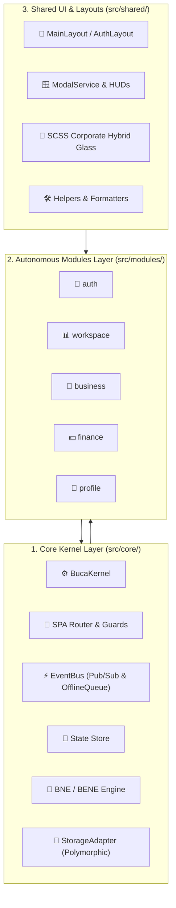

# 🏗️ Arquitectura de Software y Clean Core — B.U.C.A. AI
## Diseño en Tres Capas, Orquestación del Kernel y Patrón Thin Shell

> **Ecosistema:** B.U.C.A. AI  
> **Patrón:** Clean Core 3-Tier Layered Design (Vanilla JS ES6+)  
> **Estado:** `[Producción v1.1.8-alpha]` | `[Investigación v6.0.0]`

---

## 🌟 La Arquitectura Clean Core de Tres Capas

B.U.C.A. AI opera bajo una estricta segregación de responsabilidades en tres capas concéntricas, erradicando cualquier dependencia de frameworks externos (React, Vue, Angular):

---

## 📚 Mapa de Navegación Arquitectónica

* **[⚙️ Ciclo de Vida del Kernel y Bootloader (`kernel-lifecycle.md`)](file:///c:/wamp64/www/Clepces/projects/buca-ai/docs/architecture/kernel-lifecycle.md)**  
  Secuencia procedural de arranque, guardias de navegación y orquestación del estado global.
* **[📦 ModuleLoader y Resiliencia de Red (`module-loader.md`)](file:///c:/wamp64/www/Clepces/projects/buca-ai/docs/architecture/module-loader.md)**  
  Carga asíncrona diferida, code-splitting y precarga en periodos ociosos (`requestIdleCallback`).
* **[🛰️ Patrón Workspace Thin Shell (`workspace-thin-shell.md`)](file:///c:/wamp64/www/Clepces/projects/buca-ai/docs/architecture/workspace-thin-shell.md)**  
  Contenedor satélite ligero y orquestación modular sin sobrecarga del DOM.
* **[🚀 Hoja de Ruta de Ingeniería Futura (`future-roadmap.md`)](file:///c:/wamp64/www/Clepces/projects/buca-ai/docs/architecture/future-roadmap.md)**  
  *(new)* Service Workers PWA con precarga de navegación y aislamiento en Web Workers.
