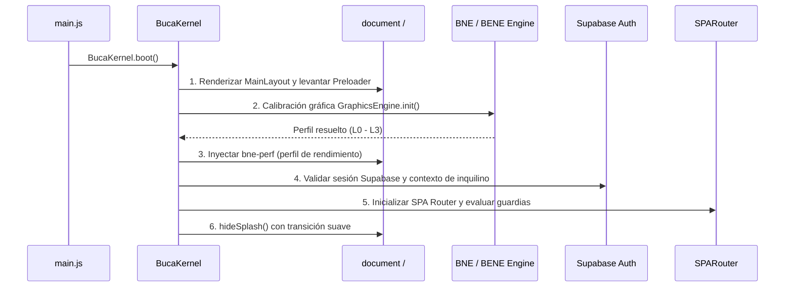

# ⚙️ Ciclo de Vida del Kernel y Secuencia de Arranque
## Orquestación del Bootloader SPA — B.U.C.A. AI

> **Módulo:** `docs/architecture/kernel-lifecycle.md`  
> **Archivo Fuente:** `src/core/kernel.js`  
> **Estado:** `[Producción v1.1.24-alpha]`

---

## 1. Secuencia Procedural de Arranque

El archivo `src/core/kernel.js` gobierna el ciclo de vida del sistema operativo SPA mediante las siguientes fases estrictas:

1. **Pre-Render y Layout Base:** Monta el esqueleto HTML de `MainLayout` y activa el preloader visual para evitar saltos de pantalla (FOUC).
2. **Calibración de Hardware:** Evalúa memoria, hilos de CPU y GPU antes de permitir que la interfaz se dibuje.
3. **Validación de Sesión:** Verifica si existe un JWT activo en `buca_supabase_auth` y consulta el estado MFA (AAL2).
4. **Enrutamiento:** Conmuta la ruta inicial evaluando permisos de acceso.
5. **Finalización:** Oculta el preloader mediante transiciones nativas por GPU.

---

## 2. Guardias del Sistema (`src/core/router/guards.js`)

* **`authGuard`:** Bloquea rutas protegidas (`/workspace`, `/finance`, `/profile`) redirigiendo a `/auth/login` si no hay sesión activa.
* **`mfaGuard`:** Si la cuenta requiere AAL2 y no ha superado el desafío TOTP, redirige de forma forzada a `/auth/two-factor`.
* **`roleGuard`:** Verifica permisos RBAC contra `public.profiles.platform_role`.

---

## 3. Servicios Transversales, Red Lenta y Teardown

* **`ActionDispatcher` + `SharedActions`:** Delegación global `[data-action]` O(1) con sanitización de payloads y desacoplamiento total entre el Kernel y los modales UI (`src/shared/ui/services/shared-actions.js`).
* **`system-helper.js`:** Frontera segura para acceso a `window.*` (`getPath`, `getHash`, `goBack`, `getValidatedOrigin`, `safeReload`).
* **Service Worker (`public/sw.js`) y Watchdog (`index.html`):** En desarrollo Vite se omiten peticiones `/src/` y `?t=`; en producción los assets con hash usan *Cache-First* y los documentos HTML usan *Network-First*. El Watchdog adapta su timeout en redes `2g`/`3g` y ofrece botón explícito `#buca-watchdog-retry`.
* **Teardown (`Kernel.destroy()`):** Libera suscripciones del `EventBus` y desmonta servicios (`NotificationService`, `ActivityLogService`, `SearchService`, `KeyboardShortcuts`, `ActionDispatcher`, `SharedActions`, `ModalService`, `TooltipService`, `ThemeManager`, `Router` y `GraphicsEngine`).
