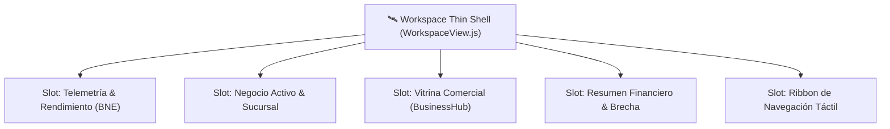

# 🛰️ Patrón Workspace Thin Shell
## Contenedor Satélite y Orquestación Modular — B.U.C.A. AI

> **Módulo:** `docs/architecture/workspace-thin-shell.md`  
> **Ubicación en Código:** `src/modules/workspace/`  
> **Estado:** `[Producción v1.1.8-alpha]`

---

## 1. Filosofía del Contenedor Delgado (*Thin Shell*)

En lugar de crear un panel masivo monolítico que contenga todas las vistas del negocio en un solo archivo, el módulo `workspace` actúa como un **Cascarón Satélite Ultraligero**:

* **Peso Mínimo:** Su vista principal (`WorkspaceView.js`) pesa menos de 150 líneas.
* **Orquestación Desacoplada:** Provee ranuras (*slots*) de montaje dinámico donde se incrustan los componentes de otros dominios:
  - Widget de Telemetría Gráfica y Monitoreo (BNE).
  - Vitrina de Comercios (`BusinessHub`).
  - Resumen de Tasas Cambiarias y Brecha (`FinanceWidget`).
  - Accesos Rápidos del Ribbon Horizontal.

---

## 2. Ventajas Arquitectónicas

1. **Cero Acoplamiento:** Los módulos de negocio no dependen del código interno del Workspace. Se comunican exclusivamente a través del `EventBus`.
2. **Mitigación de Reflow:** El layout del Workspace utiliza la propiedad `contain: content;` para garantizar que las animaciones dentro de un widget no fuercen el recálculo geométrico del resto de la pantalla.
3. **Destrucción Eficiente en Memoria:** Al cambiar a una vista dedicada (como `/pos`), el cascarón destruye sus widgets secundarios en un solo ciclo de renderizado.
