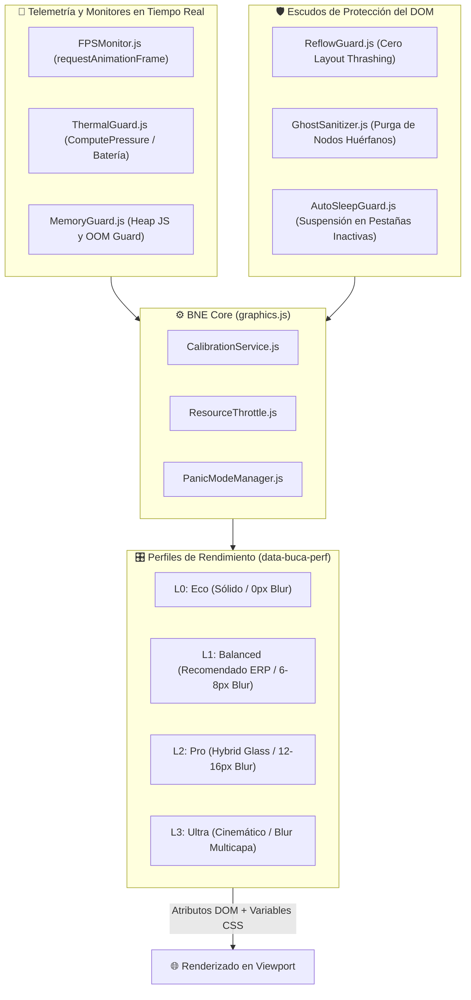

# 🎨 BNE v5.3.0 — Especificación Técnica y Arquitectura de Producción

> **Subsistema:** BUCA Neural Engine (BNE v5.3.0)  
> **Ubicación en Código:** `src/core/engine/`  
> **Directiva Fundamental:** `BNE-RULE-001` (Degradación L0 Eco Obligatoria)

---

## 1. Visión General

La versión v5.3.0 de **BNE** opera como el subsistema centralizado de calibración gráfica y optimización visual en tiempo real dentro de B.U.C.A. AI. Su función primordial es garantizar una tasa de refresco constante de **60 FPS estables**, eliminando tirones de pantalla (*stuttering*) y sobrecargas de GPU mediante la degradación dinámica del lenguaje visual *Corporate Hybrid Glass*.

---

## 2. Componentes del Núcleo v5.3.0

### 2.1. Monitores de Hardware
- **`FPSMonitor.js`:** Monitorea la frecuencia de fotogramas mediante `requestAnimationFrame`. Si el rendimiento cae por debajo de 30-40 FPS durante 3 segundos, degrada el perfil temporalmente.
- **`ThermalGuard.js`:** Supervisa la presión térmica (`ComputePressureObserver`) y el nivel de batería (`navigator.getBattery`). Activa automáticamente el modo `L0 Eco` ante agotamiento de batería o calor excesivo.
- **`MemoryGuard.js`:** Verifica el uso de memoria RAM (`performance.memory`). Si supera el 80% del límite de heap, desencadena purgas de recursos en caché.

### 2.2. Escudos de Protección
- **`ReflowGuard.js`:** Agrupa mutaciones en colas de lectura y escritura para erradicar el *Layout Thrashing*.
- **`GhostSanitizer.js`:** Purga selectores y nodos huérfanos durante ciclos de inactividad (`requestIdleCallback`).
- **`AutoSleepGuard.js`:** Detecta cuando la pestaña pasa a segundo plano o no registra actividad cinestésica en 5 segundos, suspendiendo los monitores de alta frecuencia para reducir el consumo de CPU a un 0% neto.

---

## 3. Matriz de Perfiles (L0 - L3)

| Perfil | Atributo DOM | Blur | Fondo | FPS Objetivo |
|---|---|:---:|---|:---:|
| **L0 Eco** | `data-buca-perf="L0"` | **0px** | `var(--surface-solid)` | 30 / 60 |
| **L1 Balanced** | `data-buca-perf="L1"` | 6-8px | `var(--surface-glass)` | 60 |
| **L2 Pro** | `data-buca-perf="L2"` | 12-16px | `var(--surface-glass)` | 60 |
| **L3 Ultra** | `data-buca-perf="L3"` | 20px+ | `var(--surface-glass-ultra)` | 120 / Nativo |

> [!NOTE]
> Para la especificación completa de tokens y directivas SCSS, consulte [docs/engine.md](../../engine.md).
