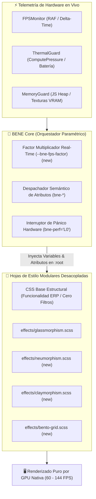

# 🧠 BENE v6.0.0 — Documento Maestro y Manifiesto de Evolución
## Balanced Effect Neural Engine — Motor Neuronal de Efecto Equilibrado

> **Ecosistema:** B.U.C.A. AI  
> **Área:** Motor Gráfico, Telemetría de Hardware y Orquestador Paramétrico de Efectos  
> **Estado:** Fase de Especificación de Ingeniería y Prototipado Arquitectónico  
> **Origen de Base:** `buca-style/docs/` (Mejorado, consolidado y optimizado)

---

## 🌟 1. El Salto Arquitectónico: Del Renderizado Imperativo a la Abstracción Ciega

En arquitecturas tradicionales (incluida la versión legacy v5.3.0), los motores gráficos sufren de **estreñimiento de composición**: cuando el sistema detecta caídas de frames, JavaScript ejecuta bucles imperativos sobre el DOM (`el.style.filter = 'blur(8px)'`), provocando *Layout Thrashing* y compitiendo con la lógica de negocio en el hilo principal (*Main Thread*).

**BENE v6.0.0 elimina de raíz este paradigma transformándose en un Motor Ciego (Agnóstico y Desacoplado):**
1. **El Motor no "pinta" ni inyecta estilos CSS directos:** BENE mide de forma matemática y continua la telemetría del dispositivo (FPS, calor, batería, RAM, red).
2. **Emisión de Atributos Semánticos Propietarios (`bne-*`):** Inyecta banderas atómicas y multiplicadores matemáticos en `:root`.
3. **Composición 100% Nativa en GPU:** Las hojas de estilo independientes resuelven el renderizado acelerado por hardware sin que JavaScript consuma ciclos de CPU en el proceso.

---

## 📚 2. Estructura y Navegación de la Documentación BENE v6.0.0

| Módulo Documental | Archivo | Descripción |
|---|---|---|
| **01. Núcleo y Telemetría** | [core-and-telemetry.md](file:///c:/wamp64/www/Clepces/projects/buca-ai/docs/bene/6.0.0/core-and-telemetry.md) | Constructor Singleton, `detectHardware()` predictivo y multiplicador dinámico `--bne-fps-factor`. |
| **02. Guardianes de Hardware** | [hardware-guards.md](file:///c:/wamp64/www/Clepces/projects/buca-ai/docs/bene/6.0.0/hardware-guards.md) | Especificación de `FPSMonitor`, `ThermalGuard` (ComputePressure) y `MemoryGuard` con matriz L0-L3. |
| **03. Escudos Gráficos y DRP** | [graphic-shields-drp.md](file:///c:/wamp64/www/Clepces/projects/buca-ai/docs/bene/6.0.0/graphic-shields-drp.md) | Contención por `bne-contain`, `GhostSanitizer` en `requestIdleCallback` y puente de red DRP. |
| **04. Integración Kernel y CSS** | [kernel-integration-css.md](file:///c:/wamp64/www/Clepces/projects/buca-ai/docs/bene/6.0.0/kernel-integration-css.md) | Secuencia de arranque `BucaKernel`, `ModuleLoader` lazy y la suite "Solid Physical Glass". |
| **05. Pánico y Diagnóstico** | [panic-switch-diagnostics.md](file:///c:/wamp64/www/Clepces/projects/buca-ai/docs/bene/6.0.0/panic-switch-diagnostics.md) | Protocolo del Panic Switch (Modo Cero), HUD feedback adaptativo y modo debug visual `bne-debug`. |
| **06. Matriz de Efectos Agnósticos** | [agnostic-effects-matrix.md](file:///c:/wamp64/www/Clepces/projects/buca-ai/docs/bene/6.0.0/agnostic-effects-matrix.md) | Soporte multiefecto (`bne-effect`), ambientación circadiana y extensiones `(new)`. |

---

## 🛡️ 3. Las Tres Reglas Inmutables de BENE v6.0.0

1. **`BENE-RULE-001` (Degradación L0 Obligatoria):** Todo componente que utilice efectos de translucidud, sombras pesadas o desenfoque dinámico **DEBE** poseer una variante visual para `[bne-perf="L0"]` que anule completamente `backdrop-filter` y aplique fondos opacos sólidos.
2. **`BENE-RULE-002` (Cero Inyección de Estilos en Línea):** El código JavaScript del motor tiene prohibido manipular `element.style.*`. Toda mutación visual se canaliza exclusivamente mediante atributos `bne-*` o variables CSS en `:root`.
3. **`BENE-RULE-003` (Eficiencia de Reposo Absoluto):** Tras 5 segundos sin interacción cinestésica del usuario (`pointermove`, `keydown`, `scroll`), los monitores de alta frecuencia entran en suspensión (`AutoSleepGuard`), garantizando un **0% de consumo de CPU** en reposo.
