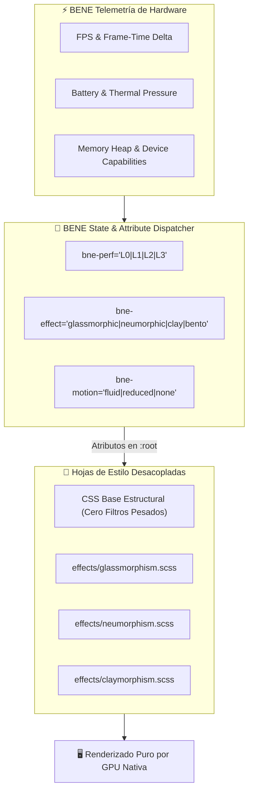

# 🚀 BENE v6.0.0 — Especificación Técnica y Plan de Evolución

> **Nombre Oficial:** BENE (Balanced Effect Neural Engine) — *Motor neuronal de efecto equilibrado*  
> **Estado:** Fase de Investigación, Especificación y Prototipado Arquitectónico  
> **Fuente de Investigación:** `buca-style/docs/bene.md` y documentos de evolución técnica  

---

## 1. El Salto Arquitectónico hacia BENE v6.0.0

La versión **v6.0.0** representa una reingeniería conceptual profunda: la transición de un motor imperativo y acoplado visualmente a un solo estilo (*Corporate Hybrid Glass*) hacia un **Sistema de Abstracción Paramétrica 100% Declarativo, Agnóstico y Universal**.

---

## 2. Los Cuatro Pilares Fundamentales

### 2.1. Motor Agnóstico de Múltiples Efectos (`bne-effect`)
BENE v6.0.0 rompe la exclusividad del diseño de cristal. Permite alternar dinámicamente entre distintos lenguajes visuales simplemente conmutando un atributo declarativo en el DOM:
- `bne-effect="glassmorphic"` (Glassmorphism de alta precisión)
- `bne-effect="neumorphism"` (Neumorfismo suave con sombras elevadas)
- `bne-effect="neubrutalism"` (Bordes marcados y alto contraste)
- `bne-effect="claymorphism"` (Volumetría suave y colores pastel)
- `bne-effect="bento-grid"` (Contenedores modulares organizados)
- `bne-effect="liquid-glass"` / `aurora-glass` (Efectos cromáticos fluidos)

Todo ello sin modificar una sola línea de código JavaScript en las vistas o componentes de negocio.

### 2.2. Desacoplamiento Radical: CSS Base vs. Capa de Efectos
- **CSS Base Natural:** Define la estructura funcional, espaciados, tipografías y el esqueleto ERP sin sobrecarga gráfica.
- **Efectos Modulares:** Hojas de estilo segregadas que aplican sombras, reflejos o desenfoques únicamente cuando el hardware lo permite.

### 2.3. Liberación Absoluta de la Carga de JavaScript
En la versión heredada (v5.3.0), JavaScript intervenía de forma imperativa alterando propiedades de los nodos DOM en tiempo de ejecución. En BENE v6.0.0, **la carga de JS en la degradación visual desaparece**. JavaScript se limita a calcular la telemetría del dispositivo y emitir los atributos semánticos (`bne-perf`, `bne-motion`) en el elemento `:root`. El navegador y el motor CSS nativo procesan el resto mediante aceleración por GPU.

### 2.4. Inteligencia Ambiental, Transiciones y Contraste Automático
- **Adaptación Dinámica de Contraste:** Evaluación de la relación de luminancia entre fondos complejos y tipografías para garantizar legibilidad WCAG AAA sin fatiga visual.
- **Transiciones Suaves en L0:** En el perfil de supervivencia `L0 Eco` (donde los desenfoques pesados están desactivados), las animaciones y transiciones cinéticas se mantienen suaves y continuas, evitando una UI tosca o recortada.

---

## 3. Hoja de Ruta de Transición (Roadmap)

| Fase | Hito | Descripción |
|---|---|---|
| **Fase A** | Especificación & Vocabulario | Definición de atributos estándar (`bne-*`) y tokens CSS universales. |
| **Fase B** | Pruebas de Desacoplamiento | Extracción de los mixins de cristal a hojas modulares independientes en `buca-style`. |
| **Fase C** | Refactorización del Dispatcher | Migración de `graphics.js` a `bene-orchestrator.js` con emisión pura de atributos. |
| **Fase D** | Validación de Rendimiento | Pruebas de carga comparativas entre v5.3.0 y v6.0.0 verificando 60 FPS con 0ms de JS blocking time. |
