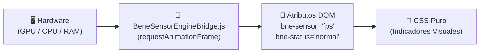

# 📡 `bne-sensor` — Especificación de Telemetría Embebida
## Widgets de Métricas en Tiempo Real para Cabeceras de Modal

> **Módulo:** `docs/bene/6.0.0/bne-sensor-telemetry.md`  
> **Componente JS:** `BeneSensorEngineBridge.js` (futuro)  
> **Estado:** `[Especificación de Investigación (new)]`

---

## 1. Visión General

`bne-sensor` es un sistema de microcomponentes de telemetría visual diseñados para incrustar métricas de rendimiento del motor gráfico directamente en las cabeceras de modales y paneles del sistema. Su propósito es proporcionar al operador feedback instantáneo sobre el estado de la GPU, el consumo de memoria y la tasa de fotogramas sin necesidad de abrir herramientas de desarrollo.



---

## 2. Anatomía del Componente Sensor

### 2.1. Atributos Semánticos

| Atributo | Valores | Propósito |
|---|---|---|
| `bne-sensor` | `fps`, `dom-count`, `memory`, `gpu-tier`, `thermal`, `render-cost` | Métrica que visualiza el sensor. |
| `bne-status` | `normal`, `warning`, `critical` | Estado cromático del indicador (verde / ámbar / rojo). |
| `bne-sensor-unit` | `fps`, `ms`, `mb`, `nodes`, `%` | Unidad de medida mostrada junto al valor. |
| `bne-sensor-label` | Texto libre | Etiqueta descriptiva opcional del sensor. |

### 2.2. Estructura HTML Canónica

```html
<!-- Sensor individual en cabecera de modal -->
<span bne-sensor="fps" bne-status="normal" bne-sensor-unit="fps">
  <span class="bne-sensor__label">FPS</span>
  <span class="bne-sensor__value">60</span>
  <span class="bne-sensor__indicator"></span>
</span>

<!-- Panel de sensores agrupados -->
<div class="bne-sensor-panel">
  <span bne-sensor="fps" bne-status="normal">
    <span class="bne-sensor__value">60</span>
  </span>
  <span bne-sensor="dom-count" bne-status="normal">
    <span class="bne-sensor__value">847</span>
  </span>
  <span bne-sensor="memory" bne-status="warning" bne-sensor-unit="mb">
    <span class="bne-sensor__value">142</span>
  </span>
</div>
```

---

## 3. Estilizado CSS Declarativo

```css
/* Indicador base */
[bne-sensor] {
  display: inline-flex;
  align-items: center;
  gap: 4px;
  font-family: 'Inter', monospace;
  font-size: 11px;
  font-variant-numeric: tabular-nums;
  padding: 2px 8px;
  border-radius: 6px;
  background: var(--surface-glass-subtle, rgba(0, 0, 0, 0.06));
}

/* Indicador de estado (punto LED) */
.bne-sensor__indicator {
  width: 6px;
  height: 6px;
  border-radius: 50%;
  flex-shrink: 0;
}

/* Estados cromáticos */
[bne-status="normal"] .bne-sensor__indicator { background: #22c55e; }
[bne-status="warning"] .bne-sensor__indicator { background: #f59e0b; }
[bne-status="critical"] .bne-sensor__indicator {
  background: #ef4444;
  animation: bne-pulse-critical 1s ease-in-out infinite;
}

@keyframes bne-pulse-critical {
  0%, 100% { opacity: 1; }
  50% { opacity: 0.4; }
}

/* Degradación L0: sensores se ocultan para liberar GPU */
[bne-perf="L0"] [bne-sensor] {
  display: none !important;
}
```

---

## 4. `BeneSensorEngineBridge.js` — Patrón de Actualización

```javascript
/**
 * Bridge reactivo entre BENE Engine y los sensores DOM.
 * Principio: Atributos son DATA HOOKS, nunca presentación.
 * Actualizaciones vía requestAnimationFrame para evitar Layout Thrashing.
 */
class BeneSensorEngineBridge {
  #sensors = new Map();
  #thresholds = {
    fps: { warning: 45, critical: 30 },
    'dom-count': { warning: 1500, critical: 3000 },
    memory: { warning: 150, critical: 250 },
  };

  mount(container) {
    const nodes = container.querySelectorAll('[bne-sensor]');
    nodes.forEach(node => {
      const metric = node.getAttribute('bne-sensor');
      this.#sensors.set(metric, node);
    });
  }

  update(metric, value) {
    const node = this.#sensors.get(metric);
    if (!node) return;

    // Actualizar valor en el próximo frame de animación
    requestAnimationFrame(() => {
      const valueEl = node.querySelector('.bne-sensor__value');
      if (valueEl) valueEl.textContent = value;

      // Calcular estado basado en umbrales
      const thresholds = this.#thresholds[metric];
      let status = 'normal';
      if (thresholds) {
        if (metric === 'fps') {
          if (value <= thresholds.critical) status = 'critical';
          else if (value <= thresholds.warning) status = 'warning';
        } else {
          if (value >= thresholds.critical) status = 'critical';
          else if (value >= thresholds.warning) status = 'warning';
        }
      }
      node.setAttribute('bne-status', status);
    });
  }

  unmount() {
    this.#sensors.clear();
  }
}
```

---

## 5. Principios de Arquitectura

1. **Atributos como Data Hooks:** `bne-sensor` y `bne-status` son **exclusivamente ganchos de datos**. Toda la presentación se resuelve con CSS puro; JavaScript solo escribe atributos, nunca manipula estilos inline.
2. **Zero Layout Thrashing:** Las actualizaciones de valores deben siempre ejecutarse dentro de `requestAnimationFrame()`.
3. **Degradación L0 Automática:** En perfil `bne-perf="L0"`, los sensores se ocultan completamente vía CSS para liberar ciclos de GPU y CPU.
4. **Composición Futura:** Soporte planificado para sensores compuestos (`bne-sensors="fps,dom-count"`) que renderizarán múltiples métricas en un solo componente compacto tipo sparkline.

> [!TIP]
> `(new)` Los sensores se integrarán en el `PerformanceModal` full-screen como dashboard principal de telemetría, ofreciendo una vista consolidada de todos los indicadores del motor gráfico.
