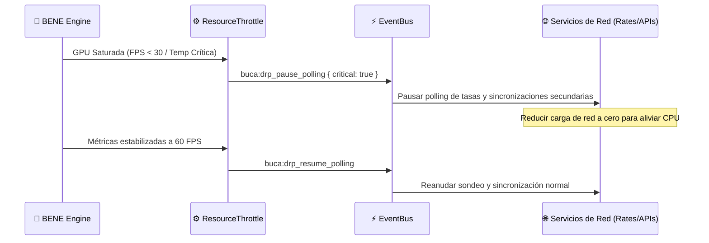

# 🛡️ Escudos de Contención Gráfica y Planificación Profunda de Recursos (DRP)
## Especificación de Estabilidad de Renderizado y Red — BENE v6.0.0

> **Módulo:** `docs/bene/6.0.0/graphic-shields-drp.md`  
> **Componentes en Código:** `src/core/engine/shields/` (`ReflowGuard.js`, `GhostSanitizer.js`, `ResourceThrottle.js`)  
> **Estado:** Especificación Técnica de Alta Fidelidad

---

## 1. `ReflowGuard`: Aislamiento Geométrico con `bne-contain`

El `ReflowGuard` intercepta el fenómeno de *Layout Thrashing* (congelamiento de pantalla provocado por cálculos geométricos síncronos redundantes en el DOM). En BENE v6.0.0, este escudo automatiza la inyección del atributo nativo **`bne-contain`**.

### Algoritmo de Detección de Mutación Caliente

1. **Muestreo por Eventos:** Escucha de forma reactiva el canal `ui:scan_graphics`, contabilizando los picos de mutación geométrica.
2. **Ventana Temporal Síncrona:** Bucle de verificación de 1000 milisegundos mediante marcas de tiempo de alta precisión (`performance.now()`).
3. **Umbral de Saturación:** Si el contador supera las **80 mutaciones por segundo**, asume repintados masivos que comprometen la fluidez del ERP.

### Protocolo de Contención Automatizada

Al rebasar el umbral:
- Inyecta la bandera global `.buca-reflow-throttle` en el elemento raíz `html`.
- Ordena al motor degradar el perfil de calidad (`engine.degrade()`).
- **Aislamiento por `bne-contain="strict"`:** Escanea el contenedor activo y le inyecta `bne-contain="strict"`, forzando la directiva CSS:
  ```css
  [bne-contain="strict"] {
      contain: strict; /* Aísla layout, estilo y pintura del widget */
  }
  ```
  Esto le indica al motor de renderizado del navegador: *"Las mutaciones internas de este widget están aisladas; no recalcules el diseño global del ERP"*.

---

## 2. `GhostSanitizer`: Recolector de Basura Gráfica y Purga de VRAM

Erradica las "capas fantasma": nodos que han sido ocultados visualmente pero retienen búferes de composición pesados en la memoria de vídeo de la GPU debido a opacidades a cero o propiedades `will-change` huérfanas.

### Planificación en Periodos de Inactividad (`requestIdleCallback`)

Para no competir con los hilos de cálculo del ERP, ejecuta rutinas de purga cada 30 segundos utilizando ciclos ociosos del navegador:

```javascript
sanitize() {
    if (this.engine.isPaused || document.hidden) return;

    if ('requestIdleCallback' in window) {
        if (!this._boundSanitize) {
            this._boundSanitize = () => this.#performSanitize();
        }
        requestIdleCallback(this._boundSanitize);
    } else {
        setTimeout(() => this.#performSanitize(), 100);
    }
}
```

### Protocolo de Purga en el Árbol del DOM

1. **Detección de Capas Residuales:** Identifica nodos con clases de ocultación pero con contextos de composición activos, omitiendo aquellos marcados explícitamente con `[bne-ignore]`.
2. **Destrucción Física de Contexto:** Aplica síncronamente `display: none`. Esto destruye de forma inmediata la textura en la GPU, liberando memoria de vídeo al instante.
3. **Reporte a Telemetría:** Registra el total de nodos purgados y actualiza las estadísticas de VRAM en el motor.

---

## 3. `ResourceThrottle`: Planificación Profunda de Recursos (DRP Bridge)

El `ResourceThrottle` actúa como el puente táctico entre el motor gráfico y los servicios de red (`Fetch`, `WebSocket`, `EventBus`). Opera bajo el principio de **Equilibrio Asimétrico de Hardware**: ante un cuello de botella severo de GPU/CPU, la plataforma da prioridad absoluta a la estabilidad visual pausando tareas secundarias de red.

### Protocolo DRP de Red (Pausa y Reanudación de Sondeo)



- **`enableThrottling(isCritical)`:** Emite `buca:drp_pause_polling`. Los clientes HTTP detienen consultas de tasas en tiempo real, notificaciones no críticas y telemetría secundaria.
- **`disableThrottling()`:** Al restablecerse los 60 FPS, emite `buca:drp_resume_polling` para normalizar el flujo de red.
- `(new)` **Throttling en WebSockets y Realtime:** En estado crítico, reduce la tasa de actualización de canales de suscripción en tiempo real de Supabase, acumulando deltas en colas locales.

---

## 4. Directrices de Desmantelamiento Seguro (`stop()`)

Para prevenir fugas pasivas de memoria (*Memory Leaks*):
1. **Limpieza de Listeners:** Todo método `stop()` en `ResourceThrottle` y `ReflowGuard` debe desuscribir obligatoriamente los escuchadores de eventos (`graphics:tier-changed`, `ui:scan_graphics`).
2. **Cero Mutaciones de Interfaz:** `GhostSanitizer` debe alterar únicamente `display: none` en nodos fantasma, sin inyectar estilos o transiciones que puedan disparar nuevos ciclos de reflow colaterales.
