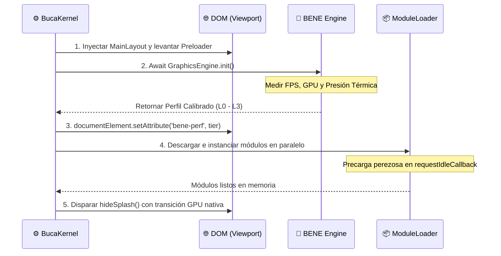

# 🏛️ Integración con el Kernel y Reglas de Diseño Paramétrico CSS
## Especificación de Acoplamiento y Lenguaje Visual — BENE v6.0.0

> **Módulo:** `docs/bene/6.0.0/kernel-integration-css.md`  
> **Componentes en Código:** `src/core/kernel.js`, `src/core/loader/ModuleLoader.js`, `src/shared/styles/neural/`  
> **Estado:** Especificación Técnica de Alta Fidelidad

---

## 1. El Ciclo de Vida del Arranque SPA (`BucaKernel`)

El encendido de **B.U.C.A. AI** se ejecuta en una secuencia lineal estricta coordinada por `core/kernel.js`. El motor gráfico BENE actúa como un paso obligatorio de validación de hardware antes de liberar la interfaz de usuario.

### Secuencia del Bootloader Desacoplado



1. **Montaje Estructural (`_renderMainLayout`):** El Kernel inyecta `MainLayout` en `#app` y despliega la pantalla de carga interina (`#global-preloader`).
2. **Política Cero Glass en Preloader:** `#global-preloader` utiliza CSS base sólido (`--preloader-bg`, `--preloader-accent`, `--preloader-badge-*`) sin `backdrop-filter`. Los realces visuales (`drop-shadow`, `box-shadow` en barra de progreso) se aplican únicamente mediante `[bene-perf="L2"]` y `[bene-perf="L3"]`.
3. **Excepción Controlada en `L0`:** `[bene-perf="L0"]` mantiene colores sólidos de alto contraste, suprime las animaciones de entrada/salida de badges y permite a `hideSplash()` remover el splash de forma inmediata sin esperar `animationend`.
4. **Inyección Primaria:** Inyecta `bene-perf` en `document.documentElement`.
5. **Desmantelamiento Seguro del Preloader (`_finalizeBoot`):** Emite `buca:app-ready`, cancela el Watchdog y ejecuta `hideSplash()` limpiando timers y `AbortController`.

---

## 2. `ModuleLoader`: Precarga en Reposo (*Lazy Prefetching*)

Garantiza que la descarga de código pesado no compita con los hilos de renderizado de la GPU:

```javascript
prefetch(moduleName) {
    if (this.loadedModules.has(moduleName) || this.loadingPromises.has(moduleName)) return;

    const doPrefetch = () => {
        if (DYNAMIC_REGISTRY[moduleName]) {
            DYNAMIC_REGISTRY[moduleName]().catch(() => {});
        }
    };

    // Precargar módulos únicamente cuando la CPU del cliente esté ociosa
    if (typeof window !== 'undefined' && 'requestIdleCallback' in window) {
        window.requestIdleCallback(doPrefetch, { timeout: 2000 });
    } else {
        setTimeout(doPrefetch, 500);
    }
}
```

---

## 3. Especificación de la Suite "Solid Physical Glass"

El lenguaje visual deja de ser estático y se convierte en un sistema paramétrico reactivo gobernado por variables dinámicas:

* **Frosted Glass Adaptativo:**
  ```css
  backdrop-filter: blur(calc(20px * var(--bene-blur-factor, 1))) saturate(180%);
  -webkit-backdrop-filter: blur(calc(20px * var(--bene-blur-factor, 1))) saturate(180%);
  ```
* **Specular Highlights & Inner Glow:** Gradientes cruzados a 45° con opacidad regulada por hardware y sombras internas (`box-shadow: inset`) para acentuar la tridimensionalidad física.
* **Control de Capas y Overdraw (`bene-layer`):**
  - `bene-layer="base"` (Dashboard principal): Blur 20px.
  - `bene-layer="overlay"` (Modales de cristal): Blur 12px con resplandor perimetral.
  - `bene-layer="nested"` (Popovers flotantes): Blur 5px para proteger la GPU.
* **Protección en Envío de Formularios:**
  Al procesar solicitudes, BENE inyecta `bene-asset-status="loading"`, aplicando:
  - `pointer-events: none !important;` (bloquea físicamente dobles envíos).
  - Animación perimetral suave de borde cónico, sustituida por indicador estático en `L0`.

---

## 4. Hoja de Estilos Paramétrica (`bene-glass-core.css`)

```css
/* ==========================================================================
   SUITE VISUAL SOLID PHYSICAL GLASS (bene-effect="glassmorphic")
   ========================================================================== */
[bene-effect="glassmorphic"] {
  position: relative;
  overflow: hidden;
  border-radius: 16px;
  background: rgba(255, 255, 255, calc(0.06 * var(--bene-blur-factor, 1)));
  border: 1px solid rgba(255, 255, 255, calc(0.12 * var(--bene-glow-factor, 1)));
  backdrop-filter: blur(calc(18px * var(--bene-blur-factor, 1))) saturate(180%);
  -webkit-backdrop-filter: blur(calc(18px * var(--bene-blur-factor, 1))) saturate(180%);
  box-shadow: 0 8px 32px 0 rgba(0, 0, 0, calc(0.2 * var(--bene-shadow-factor, 1)));
  transition: backdrop-filter 0.3s ease, border-color 0.3s ease, box-shadow 0.3s ease;
}

/* Modo Oscuro / Obsidian Glass */
[bene-theme="dark"] [bene-effect="glassmorphic"] {
  background: rgba(15, 23, 42, calc(0.65 * var(--bene-blur-factor, 1)));
  border-color: rgba(255, 255, 255, calc(0.08 * var(--bene-glow-factor, 1)));
}

/* DEGRADACIÓN OBLIGATORIA L0 ECO (BENE-RULE-001) */
[bene-perf="L0"] [bene-effect="glassmorphic"] {
  background: var(--surface-solid, #ffffff) !important;
  backdrop-filter: none !important;
  -webkit-backdrop-filter: none !important;
  border-color: var(--border-solid, #e2e8f0) !important;
  box-shadow: 0 2px 4px rgba(0, 0, 0, 0.05) !important;
}
[bene-theme="dark"][bene-perf="L0"] [bene-effect="glassmorphic"] {
  background: var(--surface-solid-dark, #0f172a) !important;
  border-color: var(--border-solid-dark, #1e293b) !important;
}
```

> [!NOTE]
> `(new)` **Soporte para View Transitions API:** Al conmutar entre perfiles de rendimiento (`L0` a `L3`), el motor aprovecha la API nativa `document.startViewTransition()` si está disponible, garantizando transiciones suaves sin destellos bruscos de composición.
