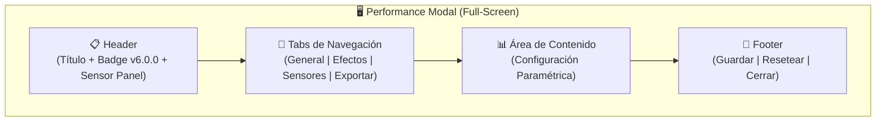

# 🖥️ Performance Modal UI — Especificación de Interfaz v6.0.0
## Panel de Control Full-Screen del Motor Gráfico BENE

> **Módulo:** `docs/bene/6.0.0/performance-modal-ui.md`  
> **Dependencias:** `bene-sensor`, `BeneSensorEngineBridge.js`, `IndexedDB`, `localStorage`  
> **Estado:** `[Especificación de Investigación (new)]`

---

## 1. Visión General

El **Performance Modal** es la interfaz de usuario principal del motor gráfico BENE v6.0.0. Se presenta como un modal full-screen que permite al operador visualizar, configurar y exportar todas las preferencias de rendimiento gráfico del sistema en un solo punto de control centralizado.



---

## 2. Estructura del Header

| Elemento | Especificación |
|---|---|
| **Título** | `Motor Gráfico BENE` — `font-size: 18px`, `font-weight: 600` |
| **Subtítulo** | `Balanced Effect Neural Engine` — `font-size: 12px`, `color: var(--text-muted)` |
| **Badge de Versión** | `v6.0.0` — pill con `background: var(--primary-color)`, `color: white`, `border-radius: 12px` |
| **Panel de Sensores** | Fila de `bene-sensor` incrustados: FPS, DOM Nodes, Memory, GPU Tier |

```html
<header class="bene-modal__header">
  <div class="bene-modal__title-group">
    <h2 class="bene-modal__title">Motor Gráfico BENE</h2>
    <p class="bene-modal__subtitle">Balanced Effect Neural Engine</p>
  </div>
  <span class="bene-modal__badge">v6.0.0</span>
  <div class="bene-sensor-panel">
    <span bene-sensor="fps" bene-status="normal">
      <span class="bene-sensor__label">FPS</span>
      <span class="bene-sensor__value">60</span>
      <span class="bene-sensor__indicator"></span>
    </span>
    <span bene-sensor="dom-count" bene-status="normal">
      <span class="bene-sensor__label">DOM</span>
      <span class="bene-sensor__value">847</span>
      <span class="bene-sensor__indicator"></span>
    </span>
  </div>
</header>
```

---

## 3. Pestañas del Modal

### 3.1. Tab: General
- **Selector de Perfil:** Radio buttons para `L0 Eco` / `L1 Balanced` / `L2 Pro` / `L3 Ultra`.
- **Modo Manual:** Toggle para desactivar autocalibración (`bene-manual="true"`).
- **Perfil Activo:** Indicador visual del perfil actualmente calibrado por hardware.

### 3.2. Tab: Efectos por Componente
- **Lista de Componentes Registrados:** Tabla con toggle individual por componente.
- Permite desactivar efectos (`bene-effect`) en componentes específicos sin afectar al resto.
- Ejemplo: Desactivar glassmorphism solo en `buca-card` del módulo `workspace`.

### 3.3. Tab: Sensores
- **Dashboard de Telemetría:** Todos los `bene-sensor` en formato de cuadrícula compacta.
- Historial de FPS (mini sparkline de los últimos 60 segundos).
- Alertas activas (sensors en estado `warning` o `critical`).

### 3.4. Tab: Exportar / Importar
- **Exportar Preset:** Botón que serializa la configuración actual a JSON y lo descarga.
- **Importar Preset:** Área de drop/input para cargar un archivo `.bene-preset.json`.
- **Formato del Preset:**
  ```json
  {
    "version": "6.0.0",
    "preset_name": "Mi Configuración ERP",
    "exported_at": "2026-11-16T20:00:00Z",
    "profile": "L2",
    "manual_override": false,
    "component_overrides": {
      "buca-card": { "effect": "none" },
      "buca-modal": { "effect": "glassmorphic" }
    },
    "theme": "dark",
    "motion": "full"
  }
  ```

---

## 4. Persistencia de Datos

| Almacén | Datos | Propósito |
|---|---|---|
| **`localStorage`** | `bene-profile`, `bene-manual`, `bene-theme` | Lectura ultra-rápida al arranque del Kernel. |
| **`IndexedDB`** | Component overrides, presets exportados, historial de sensores | Datos estructurados complejos con volumen potencialmente alto. |

> [!IMPORTANT]
> Las preferencias gráficas **NUNCA** se almacenan en Supabase (base de datos remota). Son exclusivamente locales al dispositivo del usuario, cumpliendo con la política de Cost Guard (\$0.00).

---

## 5. Características del Modal Full-Screen

| Propiedad | Especificación |
|---|---|
| **Tipo** | Modal full-screen (usa base modal compartida) |
| **Z-Index** | `3100` (capa de modales del sistema) |
| **Dimensiones** | `width: 100vw`, `height: 100vh` |
| **Fondo** | `var(--surface-solid)` con overlay sutil |
| **Scroll** | Interno con scrollbar estilizado (`max-height: 100vh`) |
| **Animación de Entrada** | `transform: translateY(100%) → translateY(0)` con `ease-out` 300ms |
| **Animación de Salida** | `transform: translateY(0) → translateY(100%)` con `ease-in` 200ms |
| **Accesibilidad** | `role="dialog"`, `aria-modal="true"`, `aria-label="Motor Gráfico BENE"` |
| **Cierre** | Botón `×`, tecla `Escape`, botón "Cerrar" en footer |

---

## 6. Degradación L0

En perfil `bene-perf="L0"`, el Performance Modal:
- Desactiva todas las transiciones de entrada/salida (render instantáneo).
- Oculta el panel de sensores del header (CPU zero).
- Reemplaza sparklines por valores numéricos estáticos.
- Fondo completamente sólido (sin backdrop-filter).

> [!NOTE]
> `(new)` El Performance Modal reemplazará el diálogo compacto actual del BNE v5.3.0, ofreciendo una experiencia de configuración completa e inmersiva que refleja la ambición del motor BENE v6.0.0.
