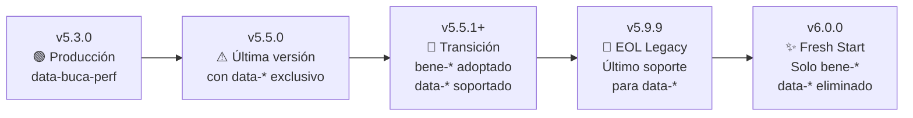

# 🔄 Tabla de Migración de Atributos Legacy → `bene-*`
## Guía de Transición del Namespace DOM del Motor Gráfico

> **Módulo:** `docs/bene/attribute-migration.md`  
> **Aplica desde:** v5.5.1 (Namespace unificado)  
> **EOL Legacy:** v5.9.9  
> **Estado:** `[Especificación de Transición (new)]`

---

## 1. Mapa de Migración Completo

| Atributo Legacy (`data-*`) | Atributo Nuevo (`bene-*`) | Versión de Adopción | Propósito |
|---|---|:---:|---|
| `data-buca-perf="L0\|L1\|L2\|L3"` | `bene-perf="L0\|L1\|L2\|L3"` | v5.5.1 | Perfil de rendimiento gráfico calibrado por hardware. |
| `data-buca-manual="true"` | `bene-manual="true"` | v5.5.1 | Override manual del perfil (desactiva autocalibración). |
| `data-buca-bloom="true"` | `bene-bloom="true"` | v5.5.1 | Efecto de resplandor perimetral en superficies de cristal. |
| `data-buca-shadows="true"` | `bene-shadows="true"` | v5.5.1 | Sombras multicapa 3D en componentes elevados. |
| `data-theme="light\|dark"` | `bene-theme="light\|dark\|oled"` | v5.5.1 | Esquema cromático activo (incluye nuevo modo OLED). |
| `data-effect="glassmorphic"` | `bene-effect="glassmorphic\|neumorphic\|claymorphic"` | v6.0.0 | Lenguaje visual declarativo aplicado al componente. |
| `data-motion="reduced"` | `bene-motion="reduced\|full"` | v6.0.0 | Preferencia de animación (respeta `prefers-reduced-motion`). |
| `data-contain="strict"` | `bene-contain="strict\|layout\|paint"` | v6.0.0 | Contención CSS para aislamiento de repintado GPU. |
| `data-layer="base\|overlay"` | `bene-layer="base\|overlay\|nested"` | v6.0.0 | Capa de profundidad del blur (controla overdraw de GPU). |
| `data-asset-status="loading"` | `bene-asset-status="loading\|ready\|error"` | v5.5.1 | Estado de carga del recurso visual (bloqueo de doble envío). |
| `data-net-profile="offline"` | `bene-net-profile="online\|offline\|metered"` | v6.0.0 | Perfil de red para activar DRP Bridge. |
| `data-ambience="natural"` | `bene-ambience="natural\|synthetic\|high-contrast"` | v6.0.0 | Perfil de iluminación ambiental (nuevo). |

---

## 2. Calendario de Deprecación



| Versión | Estado | Atributos Soportados | Notas |
|---|---|---|---|
| **v5.3.0** | 🟢 Producción actual | `data-buca-perf` | Motor legacy estable. |
| **v5.5.0** | ⚠️ Planificada | `data-buca-perf` | Última versión que usa exclusivamente `data-*`. |
| **v5.5.1 — v5.9.9** | 🔄 Transición | `bene-perf` + `data-buca-perf` (fallback) | Selector dual: `[bene-perf], [data-buca-perf]`. El motor inyecta ambos. |
| **v5.9.9** | 🔴 EOL Legacy | `bene-perf` + `data-buca-perf` (última vez) | Fin del ciclo de vida del motor legacy. |
| **v6.0.0** | ✨ Reescritura total | Solo `bene-*` | Namespace limpio. Zero legacy overhead. |

---

## 3. Estrategia de Coexistencia en SCSS (v5.5.1 — v5.9.9)

Durante la fase de transición, los mixins deben soportar ambos selectores:

```scss
// Mixin de transición dual (v5.5.1 — v5.9.9)
@mixin bene-perf-l0-fallback {
    [bene-perf="L0"] &,
    [data-buca-perf="L0"] & {
        background: var(--surface-solid) !important;
        backdrop-filter: none !important;
        -webkit-backdrop-filter: none !important;
        border-color: var(--border-solid) !important;
    }
}

// A partir de v6.0.0 — Solo namespace limpio
@mixin bene-perf-l0-fallback {
    [bene-perf="L0"] & {
        background: var(--surface-solid) !important;
        backdrop-filter: none !important;
        -webkit-backdrop-filter: none !important;
        border-color: var(--border-solid) !important;
    }
}
```

---

## 4. Qué se Hereda del Legacy y Qué se Reconstruye

| Área | ¿Se Hereda? | Notas |
|---|:---:|---|
| Lógica de `CalibrationService.js` | ✅ Parcial | Se refactoriza a multiplicadores continuos `--bene-fps-factor`. |
| `FPSMonitor.js` | ✅ Sí | Se mantiene `requestAnimationFrame` como fuente primaria. |
| `ThermalGuard.js` | ✅ Sí | Se extiende con `ComputePressureObserver` nativo. |
| `ReflowGuard.js` | ✅ Sí | Se integra como middleware del Kernel. |
| `GhostSanitizer.js` | ✅ Sí | Se mejora con detección de `WeakRef` para nodos zombi. |
| `PanicModeManager.js` | 🔄 Refactorizado | Se rediseña como sistema de eventos con `bene:panic_enter/exit`. |
| Selectores `[data-buca-perf]` en SCSS | ❌ Eliminado | Reemplazado completamente por `[bene-perf]`. |
| `ResourceThrottle.js` | 🔄 Refactorizado | Se fusiona con el nuevo DRP Bridge para coordinación CPU/GPU/Red. |
| Performance Modal UI | ❌ Desde cero | Interfaz full-screen con sensor telemetry y export de presets. |

> [!IMPORTANT]
> En el código fuente (`src/`), los atributos `data-buca-perf` permanecen **intactos** hasta que se ejecute la refactorización de código real. Esta tabla gobierna únicamente la documentación y la hoja de ruta arquitectónica.
