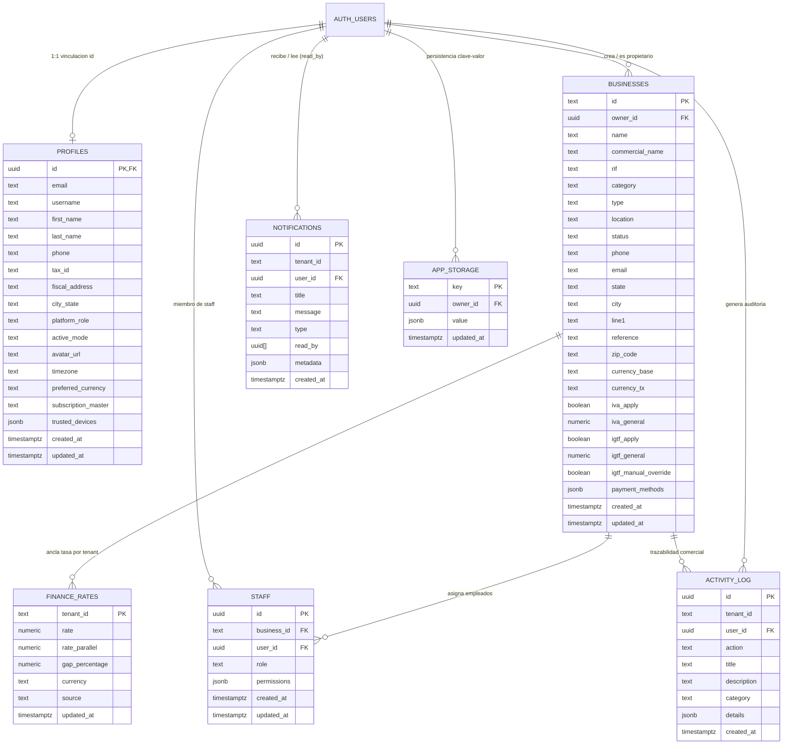

# Arquitectura de Base de Datos Supabase (PostgreSQL 3NF) — B.U.C.A. AI

**Proyecto:** B.U.C.A. AI (Business Under Control Access)  
**ID de Proyecto Supabase:** `rdvezglzxjjcfbodpfzo`  
**Versión de Plataforma:** `v1.1.7-Alpha`  
**Motor:** PostgreSQL 15+ (Supabase Cloud — Único Backend de Datos & Auth)  
**Hosting Estático:** Firebase Hosting (Vite `dist/`)  
**Estándar Aplicado:** `supabase-postgres-best-practices`

---

## 1. Modelo Entidad-Relación (3NF)

---

## 2. Diccionario de Datos Exhaustivo

### 2.1. Tabla `public.profiles`
Almacena la identidad corporativa y configuración del operador en sincronización estricta con `auth.users(id)`.

| Columna | Tipo | Nulable | Descripción / Restricciones |
| :--- | :--- | :---: | :--- |
| `id` | `uuid` | NO | Llave primaria foránea hacia `auth.users.id`. |
| `email` | `text` | SÍ | Correo principal verificado del usuario. |
| `username` | `text` | SÍ | Alias único o manejador dentro del ERP. |
| `first_name` | `text` | SÍ | Nombres del operador. |
| `last_name` | `text` | SÍ | Apellidos del operador. |
| `phone` | `text` | SÍ | Teléfono de contacto móvil o corporativo. |
| `tax_id` | `text` | SÍ | Identificador fiscal nacional (CI / RIF). |
| `fiscal_address` | `text` | SÍ | Domicilio fiscal registrado. |
| `city_state` | `text` | SÍ | Ciudad y estado de residencia / operación. |
| `platform_role` | `text` | SÍ | Rol en plataforma (`super_admin`, `admin`, `user`). |
| `active_mode` | `text` | SÍ | Modo de vista activo (`owner`, `worker`). |
| `avatar_url` | `text` | SÍ | URI del avatar del usuario. |
| `timezone` | `text` | SÍ | Zona horaria preferida (`America/Caracas`). |
| `preferred_currency`| `text` | SÍ | Moneda principal para despliegue (`VES_BCV`, `USD`). |
| `subscription_master`| `text` | SÍ | Nivel de suscripción del usuario. |
| `trusted_devices` | `jsonb`| SÍ | Dispositivos autorizados y huellas digitales SHA-256. |
| `created_at` | `timestamptz` | SÍ | Fecha de alta en la plataforma. |
| `updated_at` | `timestamptz` | SÍ | Última actualización de datos. |

---

### 2.2. Tabla `public.businesses`
Entidad principal de comercios y unidades de negocio del ERP Multi-Tenant.

| Columna | Tipo | Nulable | Descripción / Restricciones |
| :--- | :--- | :---: | :--- |
| `id` | `text` | NO | Clave primaria (`biz_` + timestamp). |
| `owner_id` | `uuid` | SÍ | FK hacia `auth.users(id)` con RLS estricto. |
| `name` | `text` | NO | Razón social oficial de la empresa. |
| `commercial_name` | `text` | SÍ | Nombre de fantasía o comercial. |
| `rif` | `text` | SÍ | Registro de Información Fiscal (J-12345678-0). |
| `category` | `text` | SÍ | Rubro comercial (Alimentos, Retail, etc.). |
| `type` | `text` | SÍ | Tipo de establecimiento (Sede Central, Sucursal). |
| `location` | `text` | SÍ | Resumen geográfico de ubicación. |
| `status` | `text` | SÍ | Estado operativo (`Active`, `Suspended`). |
| `phone` | `text` | SÍ | Teléfono comercial de la unidad. |
| `email` | `text` | SÍ | Correo electrónico de facturación. |
| `state` | `text` | SÍ | Estado o provincia. |
| `city` | `text` | SÍ | Ciudad de operación. |
| `line1` | `text` | SÍ | Dirección física detallada. |
| `currency_base` | `text` | SÍ | Moneda de anclaje base (`USD`). |
| `currency_tx` | `text` | SÍ | Moneda transaccional (`VES`). |
| `iva_apply` | `boolean` | SÍ | Si aplica impuesto al valor agregado (IVA). |
| `iva_general` | `numeric` | SÍ | Porcentaje de alícuota general (16.00). |
| `igtf_apply` | `boolean` | SÍ | Si aplica IGTF en divisas (3.00). |
| `igtf_general` | `numeric` | SÍ | Porcentaje de alícuota IGTF. |
| `payment_methods` | `jsonb` | SÍ | Métodos de pago habilitados (Pago Móvil, Zelle, etc.). |
| `created_at` | `timestamptz` | SÍ | Timestamp de creación. |
| `updated_at` | `timestamptz` | SÍ | Timestamp de actualización. |

---

### 2.3. Tabla `public.staff`
Asignación de personal operativo a unidades de negocio con control de roles (`owner`, `manager`, `worker`).

| Columna | Tipo | Nulable | Descripción / Restricciones |
| :--- | :--- | :---: | :--- |
| `id` | `uuid` | NO | Clave primaria generada por `gen_random_uuid()`. |
| `business_id` | `text` | NO | FK referenciando `public.businesses(id)`. |
| `user_id` | `uuid` | NO | FK referenciando `auth.users(id)`. |
| `role` | `text` | NO | Rol: `'owner'`, `'manager'`, `'worker'`. |
| `permissions` | `jsonb` | SÍ | Matriz granular de permisos (ventas, compras, etc.). |
| `created_at` | `timestamptz` | SÍ | Timestamp de asignación. |
| `updated_at` | `timestamptz` | SÍ | Timestamp de modificación. |

---

### 2.4. Tabla `public.finance_rates`
Sincronización cambiaria multimoneda, anclaje de tasa por tenant y monitoreo de brecha cambiaria.

| Columna | Tipo | Nulable | Descripción / Restricciones |
| :--- | :--- | :---: | :--- |
| `tenant_id` | `text` | NO | Clave primaria (`'default'` o ID de negocio). |
| `rate` | `numeric` | NO | Tasa oficial operativa (BCV / Base VES por USD). |
| `rate_parallel` | `numeric` | SÍ | Tasa paralela de referencia (USDT / Paralelo). |
| `gap_percentage` | `numeric` | SÍ | Brecha cambiaria calculada en porcentaje `((par-off)/off)*100`. |
| `currency` | `text` | SÍ | Código de divisa base (`USD`). |
| `source` | `text` | SÍ | Fuente del feed (`BCV/DolarVzla`). |
| `updated_at` | `timestamptz` | SÍ | Timestamp de la última cotización. |

---

### 2.5. Tabla `public.notifications` (Patrón `read_by: uuid[]`)
Notificaciones del sistema y alertas con soporte para Dual-Dispatch (HUD visual inmediato + bandeja persistente multiusuario).

| Columna | Tipo | Nulable | Descripción / Restricciones |
| :--- | :--- | :---: | :--- |
| `id` | `uuid` | NO | Clave primaria generada por `gen_random_uuid()`. |
| `tenant_id` | `text` | SÍ | Negocio al que aplica la notificación (si aplica). |
| `user_id` | `uuid` | SÍ | Usuario destinatario o creador (FK `auth.users(id)`). |
| `title` | `text` | NO | Título visible de la notificación. |
| `message` | `text` | NO | Cuerpo del mensaje o alerta. |
| `type` | `text` | SÍ | Tipo: `'info'`, `'warning'`, `'success'`, `'error'`. |
| `read_by` | `uuid[]` | SÍ | Arreglo de UUIDs de usuarios que han marcado la alerta como leída. |
| `metadata` | `jsonb` | SÍ | Datos adicionales para navegación o acciones. |
| `created_at` | `timestamptz` | SÍ | Timestamp de emisión. |

---

### 2.6. Tabla `public.activity_log`
Bitácora inmutable de auditoría para trazabilidad de operaciones críticas y seguridad.

| Columna | Tipo | Nulable | Descripción / Restricciones |
| :--- | :--- | :---: | :--- |
| `id` | `uuid` | NO | Clave primaria generada por `gen_random_uuid()`. |
| `tenant_id` | `text` | SÍ | ID del tenant asociado a la acción. |
| `user_id` | `uuid` | SÍ | Operador que ejecutó la acción (FK `auth.users(id)`). |
| `action` | `text` | NO | Código de acción (`UPDATE_RATE`, `MFA_ENROLLED`, etc.). |
| `title` | `text` | NO | Título descriptivo para visualización en UI. |
| `description` | `text` | SÍ | Detalle del evento para bitácora forense. |
| `category` | `text` | SÍ | Categoría: `'operaciones'`, `'seguridad'`, `'sistemas'`. |
| `details` | `jsonb` | SÍ | Payload JSON inmutable con contexto del evento. |
| `created_at` | `timestamptz` | SÍ | Timestamp inmutable del registro. |

---

### 2.7. Tabla `public.app_storage`
Motor de persistencia genérica clave-valor para módulos y estado aislado.

| Columna | Tipo | Nulable | Descripción / Restricciones |
| :--- | :--- | :---: | :--- |
| `key` | `text` | NO | Clave única de almacenamiento. |
| `owner_id` | `uuid` | SÍ | Propietario (`null` para valores globales). |
| `value` | `jsonb` | NO | Carga útil estructurada. |
| `updated_at` | `timestamptz` | SÍ | Timestamp de actualización. |

---

## 3. Matriz de Políticas RLS (Row Level Security)

Todas las políticas aplican la directriz **`auth_rls_initplan`** encapsulando `auth.uid()` dentro de subconsultas escalares `(select auth.uid())` para garantizar evaluación única O(1) por sentencia.

| Tabla | Operación | Rol | Regla RLS (`USING` / `WITH CHECK`) |
| :--- | :---: | :---: | :--- |
| `profiles` | `SELECT` | `authenticated` | `id = (select auth.uid())` |
| `profiles` | `INSERT` | `authenticated` | `id = (select auth.uid())` |
| `profiles` | `UPDATE` | `authenticated` | `id = (select auth.uid())` |
| `profiles` | `DELETE` | `authenticated` | `id = (select auth.uid())` |
| `businesses` | `SELECT` | `authenticated` | `owner_id = (select auth.uid())` |
| `businesses` | `INSERT` | `authenticated` | `owner_id = (select auth.uid())` |
| `businesses` | `UPDATE` | `authenticated` | `owner_id = (select auth.uid())` |
| `businesses` | `DELETE` | `authenticated` | `owner_id = (select auth.uid())` |
| `staff` | `SELECT` | `authenticated, anon` | `user_id = (select auth.uid()) or exists (select 1 from businesses b where b.id = staff.business_id and b.owner_id = (select auth.uid()))` |
| `staff` | `INSERT` | `authenticated` | `exists (select 1 from businesses b where b.id = staff.business_id and b.owner_id = (select auth.uid()))` |
| `staff` | `UPDATE` | `authenticated` | `exists (select 1 from businesses b where b.id = staff.business_id and b.owner_id = (select auth.uid()))` |
| `staff` | `DELETE` | `authenticated` | `exists (select 1 from businesses b where b.id = staff.business_id and b.owner_id = (select auth.uid()))` |
| `finance_rates` | `SELECT` | `authenticated, anon` | `true` |
| `finance_rates` | `INSERT` | `authenticated` | `(select auth.uid()) is not null` |
| `finance_rates` | `UPDATE` | `authenticated` | `public.is_super_admin()` |
| `finance_rates` | `DELETE` | `authenticated` | `public.is_super_admin()` |
| `notifications` | `SELECT` | `authenticated` | `user_id is null or user_id = (select auth.uid()) or (select auth.uid())::text = any(read_by)` |
| `notifications` | `INSERT` | `authenticated` | `(select auth.uid()) is not null` |
| `notifications` | `UPDATE` | `REVOCADO` | Revocado a authenticated/anon. Gestionado por RPC `mark_notification_read(text)`. |
| `notifications` | `DELETE` | `authenticated` | `user_id = (select auth.uid())` |
| `activity_log` | `SELECT` | `authenticated` | `user_id = (select auth.uid())` |
| `activity_log` | `INSERT` | `authenticated` | `user_id = (select auth.uid())` |
| `app_storage` | `SELECT` | `authenticated` | `owner_id = (select auth.uid())` |
| `app_storage` | `INSERT` | `authenticated` | `owner_id = (select auth.uid())` |
| `app_storage` | `UPDATE` | `authenticated` | `owner_id = (select auth.uid())` |
| `app_storage` | `DELETE` | `authenticated` | `owner_id = (select auth.uid())` |

---

## 4. Matriz de Índices de Rendimiento PostgreSQL

| Tabla | Nombre del Índice | Columnas Indexadas | Propósito / Optimización |
| :--- | :--- | :--- | :--- |
| `businesses` | `businesses_owner_id_idx` | `(owner_id)` | Cubre la Foreign Key y acelera consultas RLS. |
| `businesses` | `businesses_created_at_idx` | `(created_at desc)` | Optimiza listados ordenados temporalmente. |
| `profiles` | `profiles_email_idx` | `(email)` | Acelera búsquedas y validaciones de login. |
| `app_storage` | `app_storage_owner_id_idx` | `(owner_id)` | Optimiza consultas de almacenamiento por usuario. |
| `notifications` | `notifications_user_id_idx` | `(user_id)` | Acelera filtrado por destinatario. |
| `notifications` | `notifications_created_at_idx` | `(created_at desc)` | Optimiza la carga del NotificationTray por fecha. |
| `notifications` | `notifications_read_by_idx` | `using gin (read_by)` | Índice GIN para búsquedas O(log N) en arreglos de UUID. |
| `activity_log` | `activity_log_user_id_idx` | `(user_id)` | Acelera la bitácora de acciones por usuario. |
| `activity_log` | `activity_log_tenant_id_idx` | `(tenant_id)` | Acelera reportes de auditoría por empresa. |
| `activity_log` | `activity_log_created_at_idx`| `(created_at desc)` | Optimiza despliegue en tiempo real de actividad reciente. |
| `staff` | `staff_business_id_idx` | `(business_id)` | Acelera resolución de personal por negocio. |
| `staff` | `staff_user_id_idx` | `(user_id)` | Acelera pertenencia de usuario a múltiples empresas. |
| `idempotency_keys` | `idempotency_keys_pkey` | `(idempotency_key)` | Llave primaria y resolución instantánea O(1) de deduplicación. |

---

## 5. Procedimientos Almacenados y RPCs de Mínimo Privilegio

### 5.1. `public.mark_notification_read(p_notification_id text)`
- **Seguridad:** `SECURITY DEFINER` con `SET search_path = public, pg_temp`.
- **Propósito:** Reemplaza el privilegio masivo de `UPDATE` sobre `public.notifications`. Valida estrictamente que `auth.uid()` no sea nulo, verifica la autorización del suscriptor y añade atómicamente el UID al arreglo `read_by` sin permitir la alteración de título, mensaje o metadatos.
- **Idempotencia:** Si el UID ya existe en `read_by`, la operación retorna sin mutar la fila.
