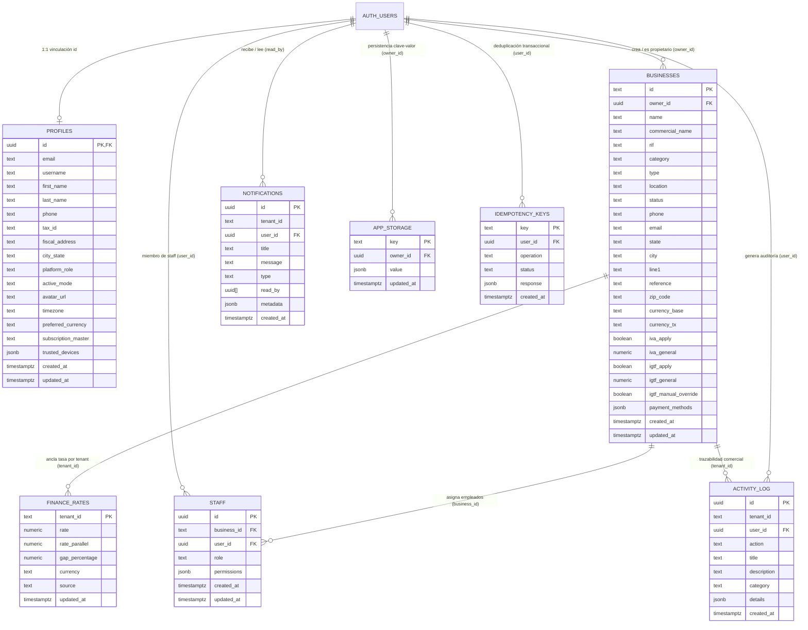

# 🐘 Arquitectura de Base de Datos Supabase (PostgreSQL 3NF) — B.U.C.A. AI

> **Documento:** Especificación Relacional, Diccionario de Datos, Políticas RLS y Procedimientos Almacenados  
> **Motor:** PostgreSQL 15+ (Supabase Cloud — Único Backend de Datos & Auth)  
> **Versión de Esquema:** 20261112000000_notifications_rpc_and_idempotency.sql  
> **Estándar de Seguridad:** `supabase-postgres-best-practices` (InitPlan O(1) con subconsultas escalares)

---

## 1. Modelo Entidad-Relación (3NF)

---

## 2. Diccionario de Datos Exhaustivo

### 2.1. Tabla `public.profiles`
Sincronizada estrictamente con `auth.users(id)` para almacenar la identidad del operador y su rol de plataforma.

| Columna | Tipo | Nulable | Descripción / Restricciones |
| :--- | :--- | :---: | :--- |
| `id` | `uuid` | NO | Llave primaria foránea vinculada a `auth.users.id`. |
| `email` | `text` | SÍ | Correo principal verificado. |
| `username` | `text` | SÍ | Alias o manejador del usuario. |
| `first_name` | `text` | SÍ | Nombres del operador. |
| `last_name` | `text` | SÍ | Apellidos del operador. |
| `phone` | `text` | SÍ | Teléfono de contacto corporativo. |
| `tax_id` | `text` | SÍ | Identificador fiscal nacional (CI / RIF). |
| `fiscal_address` | `text` | SÍ | Dirección fiscal registrada. |
| `city_state` | `text` | SÍ | Ciudad y estado de operación. |
| `platform_role` | `text` | SÍ | Rol en plataforma (`super_admin`, `admin`, `user`). Controlado por trigger. |
| `active_mode` | `text` | SÍ | Modo de interfaz activo (`owner`, `worker`). |
| `avatar_url` | `text` | SÍ | URI del avatar del usuario. |
| `timezone` | `text` | SÍ | Zona horaria preferida (`America/Caracas`). |
| `preferred_currency`| `text` | SÍ | Moneda principal para despliegue (`VES_BCV`, `USD`). |
| `subscription_master`| `text` | SÍ | Nivel de membresía o suscripción. |
| `trusted_devices` | `jsonb`| SÍ | Huellas digitales SHA-256 de dispositivos de confianza. |
| `created_at` | `timestamptz` | SÍ | Fecha de alta en la plataforma. |
| `updated_at` | `timestamptz` | SÍ | Marca temporal de última modificación. |

### 2.2. Tabla `public.businesses`
Entidad raíz para comercios y establecimientos aislados multi-inquilino.

| Columna | Tipo | Nulable | Descripción / Restricciones |
| :--- | :--- | :---: | :--- |
| `id` | `text` | NO | Identificador único del comercio (`biz_` + timestamp). |
| `owner_id` | `uuid` | SÍ | FK hacia `auth.users(id)` con aislamiento RLS. |
| `name` | `text` | NO | Razón social corporativa. |
| `commercial_name` | `text` | SÍ | Nombre de fantasía o comercial. |
| `rif` | `text` | SÍ | Registro de Información Fiscal (J-12345678-0). |
| `category` | `text` | SÍ | Rubro o actividad comercial. |
| `type` | `text` | SÍ | Tipo de sede (`Sede Central`, `Sucursal`). |
| `location` | `text` | SÍ | Resumen geográfico de ubicación. |
| `status` | `text` | SÍ | Estado operativo (`Active`, `Suspended`). |
| `phone` | `text` | SÍ | Teléfono comercial. |
| `email` | `text` | SÍ | Correo de facturación. |
| `currency_base` | `text` | SÍ | Moneda de anclaje base (`USD`). |
| `currency_tx` | `text` | SÍ | Moneda transaccional de cobro (`VES`). |
| `iva_apply` | `boolean` | SÍ | Determina si aplica IVA. |
| `iva_general` | `numeric` | SÍ | Porcentaje de alícuota general (16.00). |
| `igtf_apply` | `boolean` | SÍ | Determina si aplica IGTF en divisas (3.00). |
| `igtf_general` | `numeric` | SÍ | Porcentaje de alícuota IGTF. |
| `payment_methods` | `jsonb` | SÍ | Canales de pago habilitados (Pago Móvil, Zelle, Transferencia). |
| `created_at` | `timestamptz` | SÍ | Marca de creación. |
| `updated_at` | `timestamptz` | SÍ | Marca de modificación. |

### 2.3. Tabla `public.staff`
Asignación granular de usuarios y roles de negocio a comercios específicos.

| Columna | Tipo | Nulable | Descripción / Restricciones |
| :--- | :--- | :---: | :--- |
| `id` | `uuid` | NO | Clave primaria generada por `gen_random_uuid()`. |
| `business_id` | `text` | NO | FK hacia `public.businesses(id)`. |
| `user_id` | `uuid` | NO | FK hacia `auth.users(id)`. |
| `role` | `text` | NO | Rol en negocio: `'owner'`, `'manager'`, `'worker'`. |
| `permissions` | `jsonb` | SÍ | Matriz granular de permisos (ventas, inventario, reportes). |
| `created_at` | `timestamptz` | SÍ | Fecha de vinculación. |
| `updated_at` | `timestamptz` | SÍ | Fecha de actualización. |

### 2.4. Tabla `public.finance_rates`
Cotizaciones monetarias en tiempo real y anclajes cambiarios por inquilino.

| Columna | Tipo | Nulable | Descripción / Restricciones |
| :--- | :--- | :---: | :--- |
| `tenant_id` | `text` | NO | Clave primaria (`'default'` o identificador de negocio). |
| `rate` | `numeric` | NO | Tasa oficial operativa (BCV VES/USD). |
| `rate_parallel` | `numeric` | SÍ | Tasa de mercado de referencia (Paralelo / USDT). |
| `gap_percentage` | `numeric` | SÍ | Brecha cambiaria calculada en porcentaje `((par - off) / off) * 100`. |
| `currency` | `text` | SÍ | Divisa de referencia (`USD`). |
| `source` | `text` | SÍ | Proveedor del feed cambiario (`BCV/DolarVzla`). |
| `updated_at` | `timestamptz` | SÍ | Timestamp del último snapshot. |

### 2.5. Tabla `public.notifications`
Bandeja de alertas con patrón multiusuario `read_by: uuid[]` y mínimo privilegio.

| Columna | Tipo | Nulable | Descripción / Restricciones |
| :--- | :--- | :---: | :--- |
| `id` | `uuid` | NO | Clave primaria generada por `gen_random_uuid()`. |
| `tenant_id` | `text` | SÍ | ID del comercio aplicable (si corresponde). |
| `user_id` | `uuid` | SÍ | Usuario destinatario o emisor (FK `auth.users(id)`). |
| `title` | `text` | NO | Título de la notificación. |
| `message` | `text` | NO | Contenido de la alerta. |
| `type` | `text` | SÍ | Clasificación: `'info'`, `'warning'`, `'success'`, `'error'`. |
| `read_by` | `uuid[]` | SÍ | Arreglo de UUIDs que han marcado como leída la alerta. |
| `metadata` | `jsonb` | SÍ | Metadatos contextuales para navegación. |
| `created_at` | `timestamptz` | SÍ | Timestamp de emisión. |

### 2.6. Tabla `public.activity_log`
Bitácora inmutable de auditoría para trazabilidad de seguridad y eventos de negocio.

| Columna | Tipo | Nulable | Descripción / Restricciones |
| :--- | :--- | :---: | :--- |
| `id` | `uuid` | NO | Clave primaria generada por `gen_random_uuid()`. |
| `tenant_id` | `text` | SÍ | Comercio asociado al evento. |
| `user_id` | `uuid` | SÍ | Operador que ejecutó la acción (FK `auth.users(id)`). |
| `action` | `text` | NO | Código de acción (`UPDATE_RATE`, `MFA_ENROLLED`). |
| `title` | `text` | NO | Título legible de la acción. |
| `description` | `text` | SÍ | Descripción forense del evento. |
| `category` | `text` | SÍ | Rubro: `'operaciones'`, `'seguridad'`, `'sistemas'`. |
| `details` | `jsonb` | SÍ | Payload inmutable con contexto y diferencias. |
| `created_at` | `timestamptz` | SÍ | Timestamp inmutable del registro. |

### 2.7. Tabla `public.app_storage`
Almacén genérico clave-valor con aislamiento por propietario.

| Columna | Tipo | Nulable | Descripción / Restricciones |
| :--- | :--- | :---: | :--- |
| `key` | `text` | NO | Clave única de persistencia. |
| `owner_id` | `uuid` | SÍ | Propietario (`null` para preferencias globales). |
| `value` | `jsonb` | NO | Estructura de datos almacenada. |
| `updated_at` | `timestamptz` | SÍ | Timestamp de actualización. |

### 2.8. Tabla `public.idempotency_keys`
Control de deduplicación para operaciones offline y reintentos transaccionales.

| Columna | Tipo | Nulable | Descripción / Restricciones |
| :--- | :--- | :---: | :--- |
| `key` | `text` | NO | Hash determinista de la operación (`tx:` + hash). |
| `user_id` | `uuid` | SÍ | Operador autenticado (FK `auth.users(id)`). |
| `operation` | `text` | NO | Nombre de la operación transaccional. |
| `status` | `text` | NO | Estado: `'pending'`, `'completed'`, `'failed'`. |
| `response` | `jsonb` | SÍ | Respuesta en caché del resultado procesado. |
| `created_at` | `timestamptz` | NO | Timestamp de creación. |

---

## 3. Matriz de Políticas RLS (Row Level Security)

Todas las políticas aplican la directriz **`auth_rls_initplan`** encapsulando `auth.uid()` dentro de subconsultas escalares `(select auth.uid())` para garantizar evaluación única O(1) por sentencia.

| Tabla | Operación | Rol | Regla RLS (`USING` / `WITH CHECK`) |
| :--- | :---: | :---: | :--- |
| `profiles` | `SELECT` | `authenticated` | `id = (select auth.uid())` |
| `profiles` | `INSERT` | `authenticated` | `id = (select auth.uid()) AND (platform_role = 'user' OR platform_role IS NULL)` |
| `profiles` | `UPDATE` | `authenticated` | `id = (select auth.uid())` (Trigger bloquea escalación de `platform_role`) |
| `profiles` | `DELETE` | `authenticated` | `id = (select auth.uid())` |
| `businesses` | `SELECT` | `authenticated` | `owner_id = (select auth.uid())` |
| `businesses` | `INSERT` | `authenticated` | `owner_id = (select auth.uid())` |
| `businesses` | `UPDATE` | `authenticated` | `owner_id = (select auth.uid())` |
| `businesses` | `DELETE` | `authenticated` | `owner_id = (select auth.uid())` |
| `staff` | `SELECT` | `authenticated` | `user_id = (select auth.uid()) OR EXISTS (SELECT 1 FROM businesses b WHERE b.id = staff.business_id AND b.owner_id = (select auth.uid()))` |
| `staff` | `INSERT` | `authenticated` | `EXISTS (SELECT 1 FROM businesses b WHERE b.id = staff.business_id AND b.owner_id = (select auth.uid()))` |
| `staff` | `UPDATE` | `authenticated` | `EXISTS (SELECT 1 FROM businesses b WHERE b.id = staff.business_id AND b.owner_id = (select auth.uid()))` |
| `staff` | `DELETE` | `authenticated` | `EXISTS (SELECT 1 FROM businesses b WHERE b.id = staff.business_id AND b.owner_id = (select auth.uid()))` |
| `finance_rates` | `SELECT` | `authenticated, anon` | `true` (Lectura pública) |
| `finance_rates` | `INSERT` | `authenticated` | `EXISTS (SELECT 1 FROM profiles WHERE id = (select auth.uid()) AND platform_role = 'super_admin')` |
| `finance_rates` | `UPDATE` | `authenticated` | `EXISTS (SELECT 1 FROM profiles WHERE id = (select auth.uid()) AND platform_role = 'super_admin')` |
| `finance_rates` | `DELETE` | `authenticated` | `EXISTS (SELECT 1 FROM profiles WHERE id = (select auth.uid()) AND platform_role = 'super_admin')` |
| `notifications` | `SELECT` | `authenticated` | `user_id = (select auth.uid()) OR (select auth.uid())::text = ANY(read_by) OR EXISTS (SELECT 1 FROM businesses b WHERE b.id = target_tenant AND b.owner_id = (select auth.uid()))` |
| `notifications` | `INSERT` | `authenticated` | `user_id = (select auth.uid()) OR EXISTS (SELECT 1 FROM profiles WHERE id = (select auth.uid()) AND platform_role = 'super_admin')` |
| `notifications` | `UPDATE` | `REVOCADO` | Revocado directamente. Se actualiza exclusivamente mediante la RPC `mark_notification_read`. |
| `notifications` | `DELETE` | `authenticated` | `user_id = (select auth.uid())` |
| `activity_log` | `SELECT` | `authenticated` | `user_id = (select auth.uid()) OR EXISTS (SELECT 1 FROM profiles WHERE id = (select auth.uid()) AND platform_role = 'super_admin')` |
| `activity_log` | `INSERT` | `authenticated` | `(select auth.uid()) IS NOT NULL AND user_id = (select auth.uid())` |
| `app_storage` | `SELECT` | `authenticated` | `owner_id = (select auth.uid())` |
| `app_storage` | `INSERT` | `authenticated` | `owner_id = (select auth.uid())` |
| `app_storage` | `UPDATE` | `authenticated` | `owner_id = (select auth.uid())` |
| `app_storage` | `DELETE` | `authenticated` | `owner_id = (select auth.uid())` |
| `idempotency_keys`| `ALL` | `authenticated` | `user_id = (select auth.uid())` |

---

## 4. Matriz de Índices de Rendimiento PostgreSQL

| Tabla | Nombre del Índice | Columnas Indexadas | Propósito / Optimización |
| :--- | :--- | :--- | :--- |
| `businesses` | `businesses_owner_id_idx` | `(owner_id)` | Acelera filtrado por propietario bajo políticas RLS. |
| `businesses` | `businesses_created_at_idx` | `(created_at desc)` | Optimiza listados cronológicos. |
| `profiles` | `profiles_email_idx` | `(email)` | Búsquedas rápidas en autenticación. |
| `app_storage` | `app_storage_owner_id_idx` | `(owner_id)` | Acelera consultas de almacenamiento por usuario. |
| `notifications` | `notifications_user_id_idx` | `(user_id)` | Filtrado de alertas por destinatario. |
| `notifications` | `notifications_created_at_idx` | `(created_at desc)` | Carga rápida de bandeja de notificaciones. |
| `notifications` | `notifications_read_by_idx` | `using gin (read_by)` | Índice GIN para búsquedas de pertenencia en arreglos UUID. |
| `activity_log` | `activity_log_user_id_idx` | `(user_id)` | Filtrado de logs por usuario. |
| `activity_log` | `activity_log_tenant_id_idx` | `(tenant_id)` | Filtrado de logs por empresa. |
| `activity_log` | `activity_log_created_at_idx`| `(created_at desc)` | Paginación cronológica de auditoría. |
| `staff` | `staff_business_id_idx` | `(business_id)` | Resolución de personal por negocio. |
| `staff` | `staff_user_id_idx` | `(user_id)` | Resolución de empresas a las que pertenece un empleado. |
| `idempotency_keys` | `idempotency_keys_pkey` | `(key)` | Deduplicación O(1) de operaciones transaccionales. |

---

## 5. Procedimientos Almacenados y RPCs de Mínimo Privilegio

### 5.1. `public.mark_notification_read(p_notification_id text)`
- **Nivel de Seguridad:** `SECURITY DEFINER` con `SET search_path = public, pg_temp`.
- **Propósito:** Permite a los usuarios marcar notificaciones como leídas sin otorgarles permisos de `UPDATE` sobre la tabla.
- **Funcionamiento:**
  1. Verifica que `(SELECT auth.uid())` no sea nulo.
  2. Valida la autorización del usuario respecto al destinatario o tenant de la alerta.
  3. Ejecuta una operación idempotente: si el UID ya está en `read_by`, retorna inmediatamente `true`.
  4. Agrega atómicamente el UID al arreglo `read_by` mediante `array_append`.
