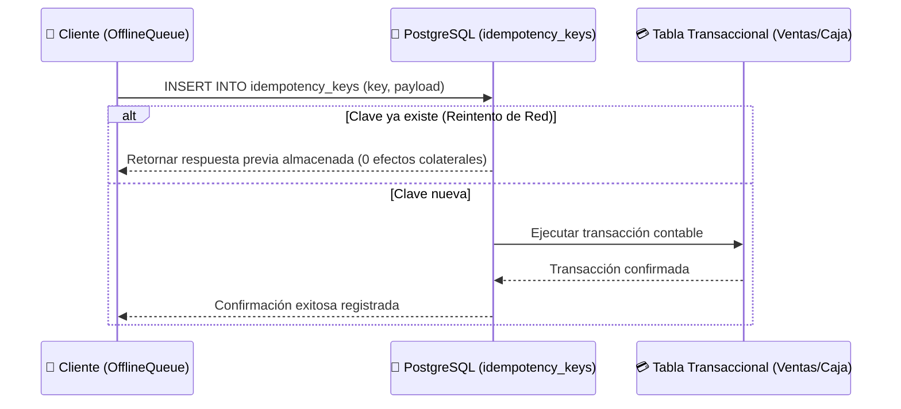

# ⚡ Idempotencia y Sincronización Offline
## Protección contra Dobles Cargos y Cola de Retransmisión — PostgreSQL / Supabase

> **Módulo:** `docs/database/offline-idempotency.md`  
> **Tabla Clave:** `public.idempotency_keys`  
> **Estado:** `[Producción v1.1.8-alpha]`

---

## 1. El Problema del Doble Despacho en Redes Inestables

Cuando un cajero o comerciante opera en zonas con caídas de conectividad frecuentes:
1. El cliente envía una transacción (ej. Venta de $50 USD).
2. La solicitud llega a la base de datos pero la conexión se corta antes de que el cliente reciba la confirmación HTTP 200.
3. El cliente o la cola automática reintenta la solicitud.
4. **Sin idempotencia:** El comercio cobraría dos veces la misma venta.

---

## 2. La Tabla `public.idempotency_keys`

```sql
CREATE TABLE IF NOT EXISTS public.idempotency_keys (
    key text PRIMARY KEY,
    owner_id uuid REFERENCES public.profiles(id) ON DELETE CASCADE,
    operation_type text NOT NULL,
    response_payload jsonb,
    created_at timestamptz DEFAULT now(),
    expires_at timestamptz DEFAULT (now() + interval '24 hours')
);

CREATE INDEX idx_idempotency_owner ON public.idempotency_keys(owner_id);
```

---

## 3. Flujo Transaccional Idempotente



> [!TIP]
> **Purga Automática:** Los registros de idempotencia caducan a las 24 horas (`expires_at`), optimizando el almacenamiento en la capa gratuita de Supabase.
