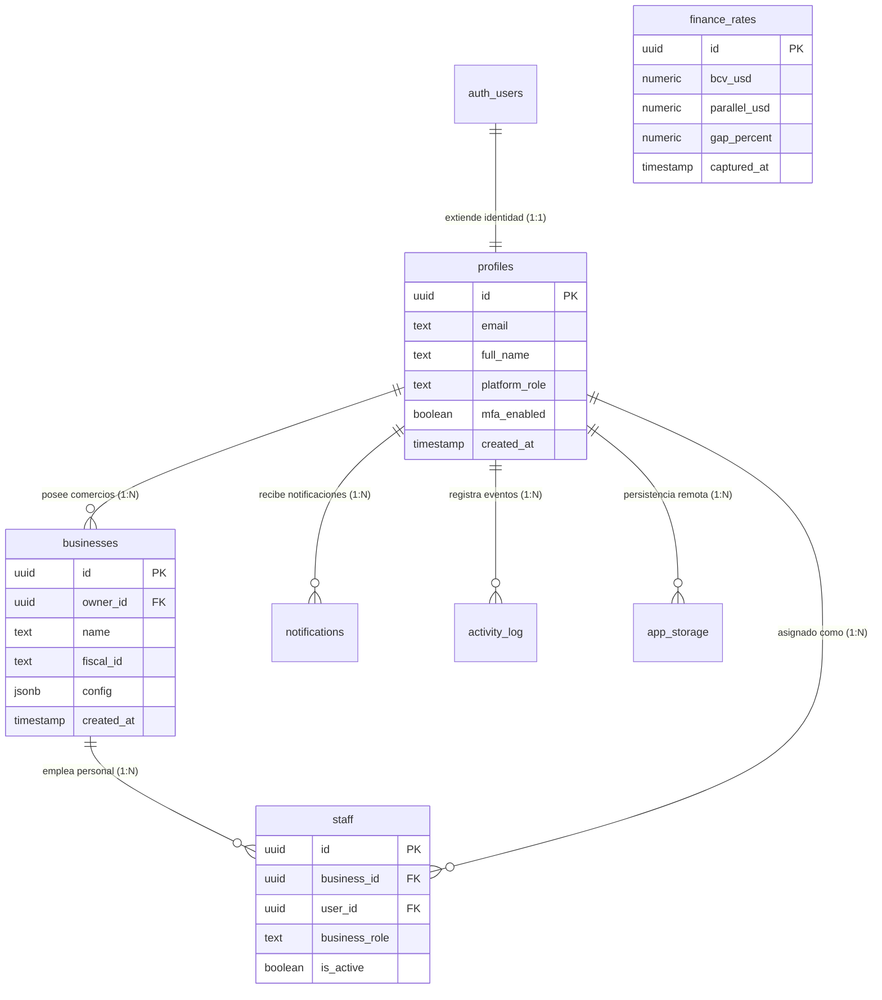

# 📊 Esquema Relacional, Tablas y Diccionario de Datos
## Especificación de Entidades y Relaciones — PostgreSQL / Supabase

> **Módulo:** `docs/database/schema-and-tables.md`  
> **Esquema:** `public`  
> **Estado:** `[Producción v1.1.8-alpha]`

---

## 1. Diagrama Entidad-Relación (ER)

---

## 2. Diccionario de Tablas Principales

### 2.1. `public.profiles`
Sincronizada automáticamente con `auth.users` mediante triggers nativos.
* `id` (`uuid`, PK): Referencia a `auth.users.id`.
* `platform_role` (`text`): `super_admin`, `admin`, `user`. Blindada contra escalada no autorizada.
* `mfa_enabled` (`boolean`): Bandera de verificación AAL2.

### 2.2. `public.businesses`
Registro de empresas y comercios del ecosistema multi-inquilino.
* `id` (`uuid`, PK): Identificador único del comercio.
* `owner_id` (`uuid`, FK): Propietario del negocio (`profiles.id`).

### 2.3. `public.finance_rates` (Snapshot Pattern)
Registro inmutable de cotizaciones históricas y brecha cambiaria.
* `bcv_usd` (`numeric(12,4)`): Tasa oficial del Banco Central.
* `parallel_usd` (`numeric(12,4)`): Tasa del mercado alternativo.
* `gap_percent` (`numeric(6,2)`): Brecha porcentual calculada en el instante exacto de la captura.
