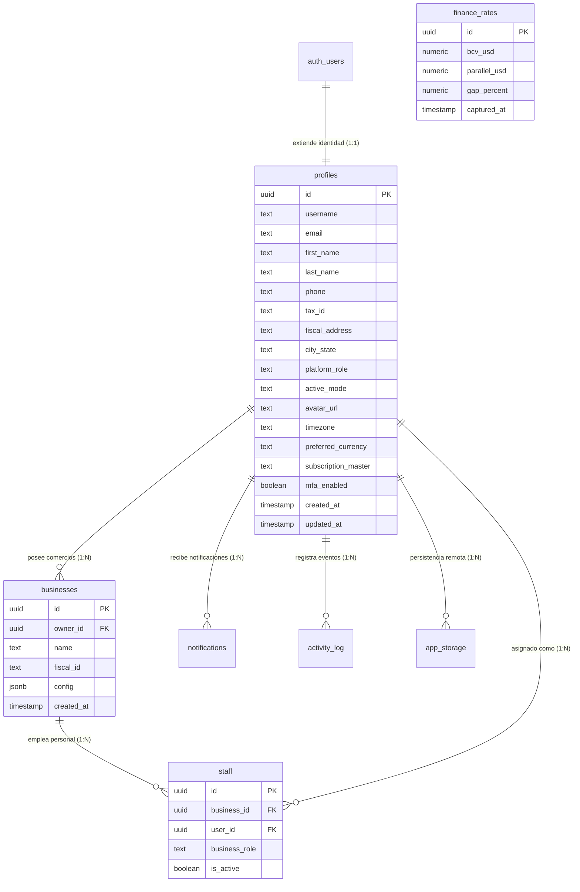

# 📊 Esquema Relacional, Tablas y Diccionario de Datos
## Especificación de Entidades y Relaciones — PostgreSQL / Supabase

> **Módulo:** `docs/database/schema-and-tables.md`  
> **Esquema:** `public`  
> **Estado:** `[Producción v1.1.8-alpha]`

---

## 1. Diagrama Entidad-Relación (ER)

---

## 2. Diccionario de Tablas Principales

### 2.1. `public.profiles`
Sincronizada automáticamente con `auth.users` mediante triggers nativos.
* `id` (`uuid`, PK): Referencia a `auth.users.id`.
* `username` (`text`): Alias único del usuario en el sistema.
* `email` (`text`): Correo electrónico principal del usuario.
* `first_name` (`text`): Nombre(s) del usuario.
* `last_name` (`text`): Apellido(s) del usuario.
* `phone` (`text`): Teléfono de contacto.
* `tax_id` (`text`): Identificación fiscal (ej. RIF / Cédula / DNI).
* `fiscal_address` (`text`): Dirección fiscal registrada.
* `city_state` (`text`): Ciudad y estado de residencia o facturación.
* `platform_role` (`text`): `super_admin`, `admin`, `user`. Blindada contra escalada no autorizada vía triggers RLS.
* `active_mode` (`text`): Modo operativo activo (`owner`, `worker`, `manager`).
* `avatar_url` (`text`): URL del avatar o foto de perfil del usuario.
* `timezone` (`text`): Zona horaria preferida (ej. `America/Caracas`).
* `preferred_currency` (`text`): Moneda base del usuario (`VES_BCV`, `USD`, etc.).
* `subscription_master` (`text`): Nivel o plan de suscripción (`FREE TIER`, `PRO`, etc.).
* `mfa_enabled` (`boolean`): Bandera de verificación AAL2 (MFA TOTP activado).
* `created_at` (`timestamp`): Fecha y hora UTC de creación de la cuenta.
* `updated_at` (`timestamp`): Fecha y hora UTC de última actualización de datos.

> **Nota de Arquitectura / Perfil Laboral Dinámico (`worker_profile`):**
> La información extendida del perfil de empleado/trabajador (`job_title`, `department`, `shift_preference`, `skills`, `availability_status`, `branch_name`, `max_discount_grant_pct`, `supervisor_name`, `experience_cards`) **no se almacena directamente como columnas estáticas en `public.profiles`**, sino que se gestiona de forma desacoplada y persistida como documento JSON mediante `SupabaseDriver` en la tabla `public.app_storage` bajo la clave `worker_profile_<uid>`. Esto preserva un esquema de base de datos relacional limpio y flexible.

### 2.2. `public.businesses`
Registro de empresas y comercios del ecosistema multi-inquilino.
* `id` (`uuid`, PK): Identificador único del comercio.
* `owner_id` (`uuid`, FK): Propietario del negocio (`profiles.id`).

### 2.3. `public.finance_rates` (Snapshot Pattern)
Registro inmutable de cotizaciones históricas y brecha cambiaria.
* `bcv_usd` (`numeric(12,4)`): Tasa oficial del Banco Central.
* `parallel_usd` (`numeric(12,4)`): Tasa del mercado alternativo.
* `gap_percent` (`numeric(6,2)`): Brecha porcentual calculada en el instante exacto de la captura.
