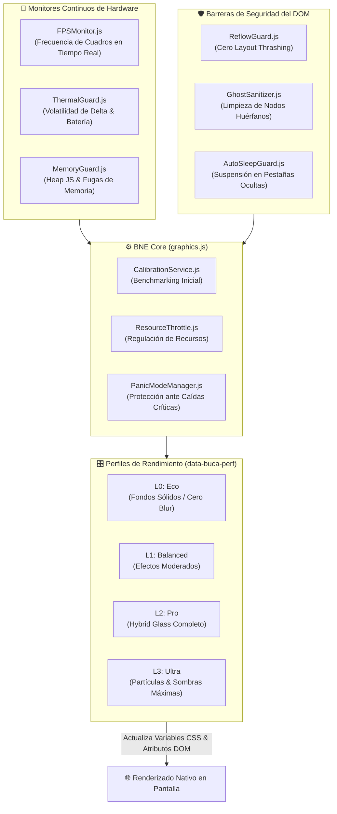

# 🎨 Motor Gráfico Adaptativo: BUCA Neural Engine (BNE v5.3.0)

> **Documento:** Especificación Técnica del Motor Gráfico, Monitores de Hardware y Perfiles de Rendimiento  
> **Ubicación en Código:** `src/core/engine/`  
> **Directiva Fundamental:** `BNE-RULE-001` (Variante de Rendimiento L0 Eco Obligatoria)

---

## 1. Visión General y Propósito del Motor

El **BUCA Neural Engine (BNE)** es el subsistema de calibración gráfica y optimización visual en tiempo real de B.U.C.A. AI. Su función principal es permitir una experiencia visual de grado aeroespacial (*Corporate Hybrid Glass*) en dispositivos de alta gama, degradando de forma inteligente y transparente la carga gráfica en dispositivos con GPUs integradas, procesadores móviles o baterías bajas, asegurando **60 FPS estables sin estrangulamiento térmico ni caídas de fotogramas**.



---

## 2. Monitores de Hardware y Telemetría en Tiempo Real

### 2.1. `FPSMonitor.js`
- **Mecanismo:** Muestreo continuo mediante bucle de `requestAnimationFrame`.
- **Cálculo de Tasa:** Ventana deslizante de 60 muestras que calcula la media cuadrática del intervalo entre cuadros ($\Delta t$).
- **Detección de Caídas:** Si el framerate desciende por debajo de 40 FPS durante más de 3 segundos consecutivos, emite una alerta interna al `PanicModeManager` para descender temporalmente un grado de calidad.

### 2.2. `ThermalGuard.js`
- **Mecanismo:** Supervisión de la volatilidad del tiempo de renderizado y consulta de la Battery Status API (`navigator.getBattery`).
- **Comportamiento ante Ahorro de Energía:** Si el dispositivo entra en modo de ahorro de batería o la batería desciende del 20%, conmuta automáticamente al perfil `L0 Eco`.

### 2.3. `MemoryGuard.js`
- **Mecanismo:** Lectura periódica de `window.performance.memory` (en navegadores basados en Chromium).
- **Prevención de OOM (Out Of Memory):** Si el consumo supera el umbral seguro (80% del límite de heap asignado), dispara una purga forzada en `GhostSanitizer` y libera cachés de imágenes en memoria.

---

## 3. Matriz de Perfiles de Rendimiento (`L0` a `L3`)

Los perfiles determinan las directivas aplicadas por `DOMEffectsApplier.js` a través del atributo global `data-buca-perf` y variables CSS dinámicas:

| Parámetro / Efecto | L0: Eco (Low) | L1: Balanced (Medium) | L2: Pro (High) | L3: Ultra (Max) |
|---|:---:|:---:|:---:|:---:|
| **Identificador Interno** | `eco` | `balanced` | `pro` | `ultra` |
| **Atributo DOM** | `data-buca-perf="L0"` | `data-buca-perf="L1"` | `data-buca-perf="L2"` | `data-buca-perf="L3"` |
| **`backdrop-filter` (Blur)** | **Desactivado (0px)** | Suave (6px - 8px) | Completo (12px - 16px) | Dinámico Multicapa (20px+) |
| **Fondo de Superficies** | `var(--surface-solid)` | `var(--surface-glass)` | `var(--surface-glass)` | `var(--surface-glass-ultra)` |
| **Efecto Bloom / Brillo** | Desactivado | Desactivado | Activo (0.8) | Activo Máximo (1.2) |
| **Sombras Dinámicas** | Desactivadas | Reducidas (Box-shadow básica) | Suaves multicapa | Dinámicas con oclusión ambiental |
| **Densidad de Partículas**| 0.0 (Sin partículas) | 0.3 | 0.8 | 1.0 (Máxima) |
| **Anti-Aliasing CSS** | Estándar | Optimizado | Subpixel Suave | Alta Fidelidad |
| **Límite de FPS** | 30 / 60 FPS | 60 FPS | 60 FPS | Sin límite (Monitor nativo) |

---

## 4. Regla de Oro del Motor Gráfico: `BNE-RULE-001`

> [!IMPORTANT]
> **Todo contenedor que emplee `backdrop-filter: blur(...)` DEBE proporcionar una variante sólida obligatoria para `[data-buca-perf="L0"]`.**

Ejemplo canónico en SCSS (`src/shared/styles/neural/abstracts/_mixins.scss`):

```scss
@mixin buca-surface-glass {
    background: var(--surface-glass);
    border: 1px solid var(--border-glass);
    backdrop-filter: blur(var(--blur-intensity));
    -webkit-backdrop-filter: blur(var(--blur-intensity));

    // Degradación obligatoria L0 para hardware modesto
    [data-buca-perf="L0"] & {
        background: var(--surface-solid) !important;
        backdrop-filter: none !important;
        -webkit-backdrop-filter: none !important;
        border-color: var(--border-solid) !important;
    }
}
```

---

## 5. Barreras de Seguridad del DOM y Ciclo de Vida Visual

### 5.1. `ReflowGuard.js`
Previene el costoso fenómeno de *Layout Thrashing* (alternancia consecutiva de lecturas y escrituras en el DOM). Agrupa las operaciones mediante una cola de lectura (`readQueue`) y una cola de escritura (`writeQueue`), ejecutando las escrituras en un solo paso dentro del siguiente tick de animación.

### 5.2. `GhostSanitizer.js`
Supervisa los componentes desacoplados del DOM. Al navegar entre rutas, busca y elimina selectores zombi, desuscribe observadores de mutación huérfanos y previene fugas de memoria en la Single Page Application.

### 5.3. `AutoSleepGuard.js`
Detecta eventos de visibilidad del documento (`visibilitychange`) y enfoque de ventana (`blur`/`focus`). Cuando el usuario cambia de pestaña, detiene inmediatamente los bucles de telemetría de FPS y pausar las animaciones intensivas, reduciendo el consumo de CPU al 0% en segundo plano.
