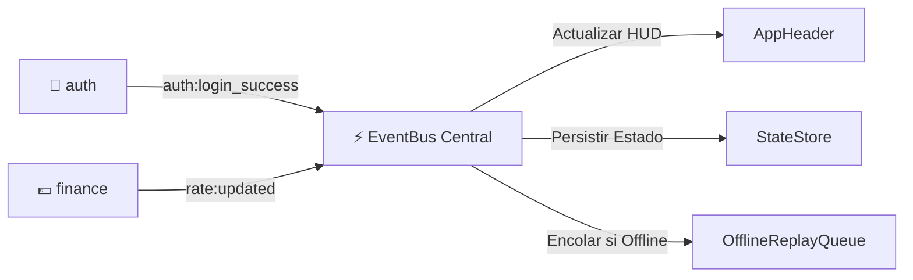

# ⚡ Bus de Eventos Reactivo y Desacoplado — B.U.C.A. AI
## Sistema Pub/Sub, Colas de Retransmisión y Comunicación Inter-Módulos

> **Ecosistema:** B.U.C.A. AI  
> **Ubicación en Código:** `src/core/eventBus/`  
> **Patrón:** Publish-Subscribe Transaccional con Respaldo Offline  
> **Estado:** `[Producción v1.1.8-alpha]` | `[Investigación (new)]`

---

## 🌟 Visión del Bus de Eventos

En **B.U.C.A. AI**, los módulos autónomos no se importan mutuamente ni llaman a métodos de otros dominios de forma directa. Toda comunicación transversal se realiza mediante el `EventBus` centralizado (`src/core/eventBus/index.js`), garantizando **acoplamiento cero**:

---

## 📚 Mapa de Navegación de Eventos

* **[📑 Catálogo Oficial de Tópicos y Canales (`event-catalog.md`)](file:///c:/wamp64/www/Clepces/projects/buca-ai/docs/events/event-catalog.md)**  
  Tópicos estándar (`auth:*`, `rate:*`, `business:*`, `ui:*`, `buca:*`), soporte de comodines y payloads.
* **[🔁 Cola de Retransmisión Offline e Idempotencia (`offline-replay-queue.md`)](file:///c:/wamp64/www/Clepces/projects/buca-ai/docs/events/offline-replay-queue.md)**  
  Drenaje secuencial, persistencia de eventos no confirmados y retransmisión garantizada.
* **[🌐 Sincronización Multi-Pestaña y Canales Futuros (`future-channels.md`)](file:///c:/wamp64/www/Clepces/projects/buca-ai/docs/events/future-channels.md)**  
  *(new)* Integración con `BroadcastChannel API` para sincronizar cotizaciones y sesión entre pestañas del navegador en tiempo real.
