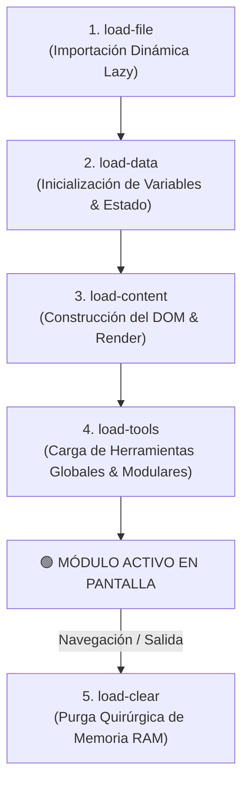

# 🔄 Ciclo de Vida del Controlador Universal y Gestión de Memoria
## Especificación Canónica de Controladores, Fases de Carga y Destrucción

> **Módulo:** `docs/modules/module-lifecycle-controller.md`  
> **Patrón:** Universal Module Controller Lifecycle (UMCL)  
> **Estado:** `[Especificación de Ingeniería (new)]`

---

## 1. Identidad Canónica del Módulo

A partir de la evolución modular de B.U.C.A. AI, todo módulo cuenta con metadatos estrictos de identificación:

```javascript
export const MODULE_METADATA = {
    name: "finance",
    serialId: "buca:mod:finance:9b1deb4d-3b7d-4bad-9bdd-2b0d7b3dcb6d",
    version: "1.2.0",
    dependencies: ["buca:mod:auth"]
};
```

* **`name`:** Nombre canónico en `kebab-case`.
* **`serialId`:** Identificador serial unificado para auditoría, telemetría y permisos RBAC.
* **`version`:** Versionado semántico independiente (`MAJOR.MINOR.PATCH`).

---

## 2. Anatomía Canónica del Directorio (8 Partes)

```text
[modulo]/
  ├── index.js          # Registro, bootstrap y ciclo de vida del módulo
  ├── routes.js         # Definición de rutas específicas y guardias
  ├── components/       # Componentes visuales UI locales
  ├── logic/            # Controladores de dominio y reglas de negocio
  ├── pages/            # Vistas principales del módulo
  ├── styles/           # Archivos SCSS locales desacoplados
  ├── services/         # Clientes de persistencia, Supabase y APIs
  └── constants/        # Enums, constantes y metadatos
```

---

## 3. Las Cinco Fases del Ciclo de Vida Universal (`UMCL`)

Para evitar sobrecargar el hilo principal de JavaScript y garantizar cero fugas de memoria, todo controlador modular implementa la interfaz de 5 fases:



### Fase 1: `load-file` (Carga Perezosa Asíncrona)
* **Objetivo:** No importar el archivo JavaScript hasta que el usuario navegue explícitamente hacia la ruta del módulo.
* **Mecanismo:** El Kernel orquesta la llamada mediante `import('./modules/finance/index.js')` dentro de `requestIdleCallback`, manteniendo el arranque del sistema en menos de 100ms.

### Fase 2: `load-data` (Estado y Esquemas)
* **Objetivo:** Cargar las variables locales, esquemas de validación Zod y datos persistidos desde `StorageAdapter` (IndexedDB/Local).
* **Mecanismo:** Validación Fail-Fast de los contratos antes de proceder al renderizado.

### Fase 3: `load-content` (Construcción del DOM)
* **Objetivo:** Renderizar las vistas (`pages`), pestañas (`tabs`) y subcomponentes.
* **Mecanismo:** Manipulación nativa del DOM (`document.createElement`, Template Literals).

### Fase 4: `load-tools` (Herramientas Globales vs. Modulares)
* **Objetivo:** Vincular los servicios requeridos por el módulo, distinguiendo formalmente dos niveles:
  1. **Herramientas Globales (`Global Tools`):** Provistas por el Kernel o el Core (`EventBus`, `StorageAdapter`, `ModalService`, `HUDToasts`, `AuthSession`). Accesibles de forma transversal.
  2. **Herramientas Modulares (`Module Tools`):** Servicios expuestos por los propios módulos para colaborar con otros módulos a través del EventBus.
     - *Ejemplo:* El módulo `finance` expone la herramienta `calculateRateGap(bcv, par)` al módulo `pos`.

### Fase 5: `load-clear` (Destrucción y Gestión de Memoria)
* **Objetivo:** Al navegar fuera del módulo, destruir de raíz cualquier residuo en memoria RAM para evitar fugas (*Memory Leaks*):
  - Desuscribir todos los escuchadores de eventos del `EventBus` (`eventBus.off(...)`).
  - Detener temporizadores activos (`clearInterval`, `clearTimeout`).
  - Desconectar observadores (`IntersectionObserver`, `MutationObserver`).
  - Vaciar arreglos de datos en caché y desvincular referencias a nodos del DOM para permitir la recolección de basura nativa (*V8 Garbage Collection*).

---

## 4. Estructura Canónica del Controlador Modular

```javascript
export class BaseModuleController {
    constructor(metadata) {
        this.metadata = metadata;
        this.subscriptions = [];
        this.timers = [];
    }

    async loadFile() { /* Carga dinámica de dependencias */ }
    async loadData() { /* Inicialización de estado y validaciones */ }
    async loadContent(container) { /* Renderizado del DOM */ }
    async loadTools() { /* Enlace de herramientas globales y modulares */ }
    
    destroy() {
        // Limpieza obligatoria de memoria
        this.subscriptions.forEach(unsub => unsub());
        this.subscriptions = [];
        this.timers.forEach(t => clearInterval(t));
        this.timers = [];
        this.container?.replaceChildren();
        console.log(`[ModuleLoader] Memoria liberada: ${this.metadata.name}`);
    }
}
```
