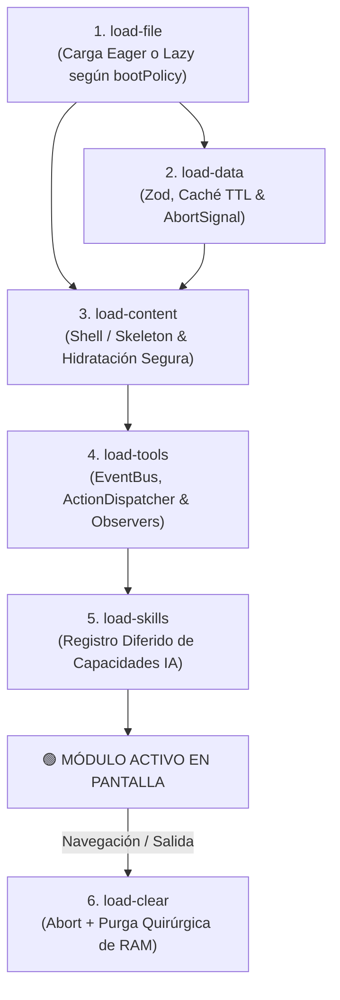

# 🔄 Ciclo de Vida del Controlador Universal y Gestión de Memoria
## Especificación Canónica de Controladores, Fases de Carga, Skills IA y Destrucción

> **Módulo:** `docs/modules/module-lifecycle-controller.md`  
> **Patrón:** Universal Module Controller Lifecycle (`UMCL v2.0`)  
> **Estado:** `[Especificación de Ingeniería Actualizada]`

---

## 1. Identidad Canónica y Metadatos en `constants/`

Todo módulo de **B.U.C.A. AI** debe declarar sus metadatos en `constants/` (p.ej. `constants/[modulo].constants.js`) para desacoplar su contrato de arranque, permisos y capacidades de IA:

```javascript
export const MODULE_METADATA = {
    name: 'finance',
    serialId: 'buca:mod:finance:9b1deb4d-3b7d-4bad-9bdd-2b0d7b3dcb6d',
    version: '1.2.0',
    contractVersion: '2.0',
    bootPolicy: 'lazy', // 'eager' para módulos críticos de arranque (ej. 'auth') | 'lazy' para negocio
    security: {
        requiresAuth: true,
        requiresAAL2: true,
        allowedRoles: []
    },
    dependencies: ['buca:mod:auth']
};
```

* **`name`:** Nombre canónico en `kebab-case`.
* **`serialId`:** Identificador serial único e inmutable del módulo con formato `buca:mod:<name>:<uuid-v4>`.
  * **Cómo se gestiona:** Se genera **una sola vez** al crear el módulo (p.ej. con `crypto.randomUUID()`) y se fija en `constants/[modulo].constants.js`. **No** se genera en tiempo de ejecución ni cambia al subir `version`.
  * **Para qué sirve:** Trazabilidad inmutable en `activity_log`, telemetría, prevención de colisiones en `ModuleLoader` / `SkillRegistry` y referencia estable en `dependencies`.
* **`version`:** Versionado semántico independiente (`MAJOR.MINOR.PATCH`).
* **`contractVersion`:** Versión del contrato `UMCL` que implementa el controlador (`'2.0'`), permitiendo evolución incremental sin romper módulos existentes.
* **`bootPolicy`:**
  * `'eager'`: Carga inmediata durante `Kernel.boot()`. Obligatorio para **`auth`** (validación Auth-First y captura temprana de eventos del SDK como `PASSWORD_RECOVERY`).
  * `'lazy'`: Carga diferida bajo demanda al navegar al módulo o en períodos ociosos (`runOnIdle`).
* **`security`:** Contrato declarativo de acceso a la UI y navegación del módulo (evaluado *Fail-Closed* por `RouterGuards`):
  * `requiresAuth` (`boolean`): Exige sesión activa (`isAuthenticated === true`) para acceder a las rutas del módulo. En vistas públicas de `auth` es `false`.
  * `requiresAAL2` (`boolean`): Exige verificación de segundo factor TOTP (`RouterGuards.requiresAAL2()`) antes de montar vistas protegidas.
  * `allowedRoles` (`string[]`): Lista blanca de roles de plataforma autorizados (`['user', 'admin', 'super_admin']`; `[]` permite cualquier usuario autenticado).
  * > **Nota de Seguridad:** `MODULE_METADATA.security` protege únicamente la navegación y el renderizado en el cliente. La autorización real de datos y operaciones reside siempre en **Supabase Auth y políticas RLS / RPCs** en el servidor.
* **`dependencies`:** Lista de módulos requeridos previamente (p.ej. `['buca:mod:auth']`).

### Tabla de Referencia Rápida (`MODULE_METADATA`)

| Campo | Tipo | Obligatorio | Consumidor Principal |
| :--- | :--- | :--- | :--- |
| `name` | `string` | Sí | `ModuleLoader`, `Router`, `Logger` |
| `serialId` | `string` | Sí | `ActivityLogService`, `SkillRegistry`, RBAC |
| `version` | `string` | Sí | Telemetría, auditoría |
| `contractVersion` | `string` | Sí | `ModuleLoader` |
| `bootPolicy` | `'eager' \| 'lazy'` | Sí | `BucaKernel`, `ModuleLoader` |
| `security` | `object` | Sí | `RouterGuards`, `Router` |
| `dependencies` | `string[]` | No | `ModuleLoader` |

---

## 2. Anatomía Canónica del Directorio (8 Partes)

```text
[modulo]/
  ├── index.js          # Registro, bootstrap y ciclo de vida del módulo
  ├── routes.js         # Definición de rutas específicas, layout y guardias
  ├── components/       # Componentes visuales UI locales (kebab-case)
  ├── logic/            # Controladores de dominio, validadores y skills IA
  ├── pages/            # Orquestadores de vista por ruta (kebab-case)
  ├── styles/           # Archivos SCSS locales desacoplados
  ├── services/         # Clientes de persistencia, Supabase y APIs
  └── constants/        # Enums, constantes, esquemas y MODULE_METADATA
```

---

## 3. Las Seis Fases del Ciclo de Vida Universal (`UMCL v2`)

Para evitar bloqueos de renderizado (*waterfall*), prevenir montajes fantasma y garantizar cero fugas de memoria en la SPA:



### Fase 1: `load-file` (Importación Controlada)
* **Módulos `lazy`:** Se importan dinámicamente al navegar hacia sus rutas mediante `ModuleLoader.load(...)`.
* **Módulos `eager` (`auth`):** Se inicializan en `Kernel.boot()` antes de montar rutas protegidas; los listeners críticos de sesión se registran síncronamente al instanciar Supabase.

### Fase 2: `load-data` (Estado, Esquemas y Red Cancelable)
* Ejecuta validaciones **Zod** y consultas con el `AbortSignal` de la instancia del controlador (`this.abortController.signal`).
* Usa caché con TTL en `IndexedDB` (`StorageAdapter`) cuando aplica para evitar llamadas redundantes.
* **Regla anti-fantasma:** Antes de hidratar resultados asíncronos en el DOM, verificar `!this._isDestroyed`.

### Fase 3: `load-content` (Renderizado Rápido y Montaje Condicional)
* Pinta el cascarón/skeleton inmediatamente con `$mount()` (nunca `innerHTML` directo) en paralelo a `load-data`, minimizando el tiempo hasta el primer pintado.
* **Seguridad de UI:** Los formularios o vistas privilegiadas se montan **condicionalmente** solo tras validar el estado autorizado (nunca pre-inyectados ocultos con `d-none`).

### Fase 4: `load-tools` (Herramientas Globales, Modulares y Frontera con `ActionDispatcher`)
* Vincula suscripciones en `eventBus`, delegación en `ActionDispatcher`, `MutationObserver` / `IntersectionObserver` y servicios transversales.
* **Regla de Frontera (`Core` vs `Modules`):** `ActionDispatcher` (en `src/core/services/`) **solo** intercepta clics `[data-action]` en el DOM y emite eventos al `eventBus`. Cada módulo es responsable de suscribirse a sus propias acciones (`modulo:accion`) dentro de `loadTools()` y limpiarlas en `load-clear` (`destroy()`). El Core nunca debe importar componentes o servicios de `src/modules/*`.
* Toda función de desuscripción debe registrarse en `this.subscriptions`.

### Fase 5: `load-skills` (Capacidades para Inteligencia Artificial)
* Registra de forma diferida (`runOnIdle`, sin bloquear el primer pintado) las habilidades declarativas que el módulo expone a agentes o asistentes de IA:
  ```javascript
  {
      name: 'finance:get_exchange_rate',
      description: 'Consulta la tasa oficial vigente.',
      inputSchema: z.object({ currency: z.enum(['USD', 'EUR']) }),
      sideEffects: 'read', // 'read' | 'write'
      requiredRole: 'user'
  }
  ```
* **Restricciones de seguridad para `load-skills`:**
  1. **Cero skills en estado pre-autenticado:** `auth` (en login, recovery o MFA pendiente) **no** registra ni expone skills de negocio.
  2. **Doble validación:** Los argumentos de entrada se validan con **Zod** en cliente y la autorización final se impone siempre en **Supabase RLS / RPCs**.
  3. **Desregistro automático:** Todas las skills registradas por el módulo se desregistran en `load-clear` al salir del módulo.

### Fase 6: `load-clear` (`destroy()`)
* Al desmontar la vista o salir del módulo:
  1. Marca `this._isDestroyed = true` y ejecuta `this.abortController.abort()`.
  2. Detiene `setInterval`, `setTimeout` y `requestAnimationFrame` registrados.
  3. Desconecta observadores (`disconnect()`) y ejecuta cada `unsub()` dentro de `try/catch` individual.
  4. Desregistra las `skills` activas del módulo.
  5. Limpia el contenedor DOM (`replaceChildren()`) y registra vía `Logger.info(...)` (prohibido `console.log`).

---

## 4. Estructura Canónica del Controlador Modular (`BaseModuleController`)

```javascript
import { Logger } from '@/shared/utils/logger.js';

export class BaseModuleController {
    constructor(metadata) {
        this.metadata = metadata;
        this.subscriptions = [];
        this.intervals = new Set();
        this.timeouts = new Set();
        this.observers = [];
        this.registeredSkills = [];
        this.abortController = new AbortController();
        this.container = null;
        this._isDestroyed = false;
    }

    trackTimeout(fn, ms) {
        const id = setTimeout(() => {
            this.timeouts.delete(id);
            if (!this._isDestroyed) fn();
        }, ms);
        this.timeouts.add(id);
        return id;
    }

    trackInterval(fn, ms) {
        const id = setInterval(() => {
            if (!this._isDestroyed) fn();
        }, ms);
        this.intervals.add(id);
        return id;
    }

    async loadFile() { /* Importación dinámica según bootPolicy */ }
    async loadData(_signal) { /* Validación Zod y carga de datos */ }
    async loadContent(container) { this.container = container; }
    async loadTools() { /* Suscripciones EventBus y observers */ }
    async loadSkills() { /* Registro diferido de skills IA si autenticado */ }

    destroy() {
        this._isDestroyed = true;
        this.abortController.abort();

        for (const id of this.timeouts) clearTimeout(id);
        for (const id of this.intervals) clearInterval(id);
        this.timeouts.clear();
        this.intervals.clear();

        for (const obs of this.observers) {
            try { obs?.disconnect?.(); } catch { /* ignore */ }
        }
        this.observers = [];

        for (const unsub of this.subscriptions) {
            try { if (typeof unsub === 'function') unsub(); } catch { /* ignore */ }
        }
        this.subscriptions = [];
        this.registeredSkills = [];

        this.container?.replaceChildren();
        this.container = null;
        Logger.info('ModuleLoader', `Memoria liberada: ${this.metadata.name}`);
    }
}
```
