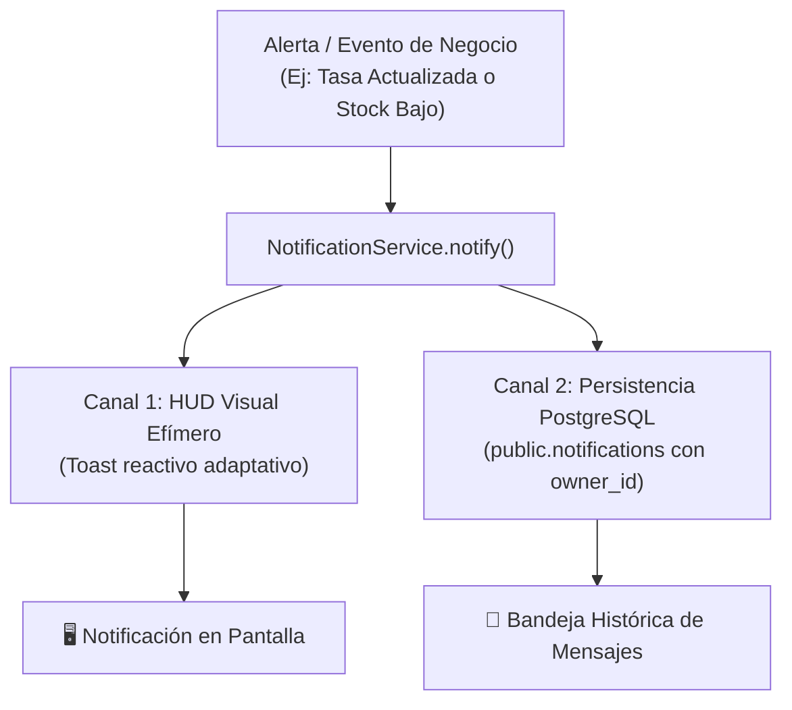

# 🔔 Sistema de Notificaciones Dual-Dispatch — B.U.C.A. AI
## Despacho Simultáneo hacia HUD Visual y Base de Datos Persistente

> **Ecosistema:** B.U.C.A. AI  
> **Servicio:** `src/core/services/NotificationService.js`  
> **Tabla Persistente:** `public.notifications`  
> **Estado:** `[Producción v1.1.8-alpha]`

---

## 🌟 Arquitectura del Despacho Dual

Toda notificación de negocio o alerta crítica se procesa bajo el patrón **Dual-Dispatch**:

1. **Canal 1 (Inmediato / Efímero):** Muestra un toast animado en pantalla con el estilo adaptativo calculado por BENE (`hud-toast--glass` o `hud-toast--eco`).
2. **Canal 2 (Persistente / Auditable):** Inserta el registro en `public.notifications` con metadatos del usuario y soporte de lectura segura mediante el RPC `mark_notification_read`.

---

## 📚 Mapa de Navegación

* **[📡 Canales Realtime y Web Push Notifications (`channels-and-push.md`)](file:///c:/wamp64/www/Clepces/projects/buca-ai/docs/notifications/channels-and-push.md)**  
  *(new)* Suscripción en tiempo real con Supabase Realtime y notificaciones nativas del sistema operativo mediante Web Push API.
