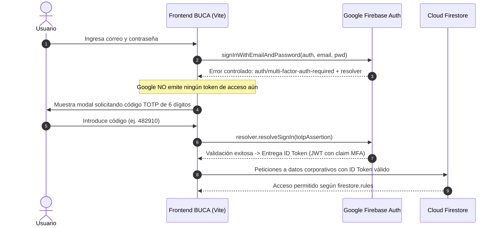

# 🔐 Plan Maestro de Implementación: Firebase Authentication MFA (Multi-Factor)

**Proyecto:** B.U.C.A. AI  
**Objetivo:** Reemplazar la verificación TOTP local en el navegador por autenticación multifactor oficial y respaldada por Firebase Identity Platform.  
**Estado:** Documento de Arquitectura y Especificación Técnica (Sin deuda técnica).

---

## 1. Justificación y Diferencia con la Solución Anterior

| Factor | Verificación Local Anterior (Insegura) | Firebase Auth MFA (Estándar Enterprise) |
|---|---|---|
| **Punto de Validación** | Navegador del cliente (`TOTPService.js`). | Servidores de Google Identity Platform. |
| **Manipulación DevTools** | Vulnerable (se podía alterar el flujo en consola F12). | Inmune (Google no emite el JWT si el 2FA no se valida). |
| **Almacenamiento del Secreto** | En Firestore (`security.totp_secret`) o `localStorage`. | En los servidores cifrados de Google; nunca expuesto al cliente. |
| **Protección en Base de Datos** | Las reglas solo sabían que el usuario inició sesión básica. | Las reglas pueden verificar que el token proviene de un inicio con MFA resuelto. |

---

## 2. Requisitos Previos en Firebase Console y Google Cloud

Para activar MFA nativo en Firebase Authentication se requiere:

1. **Vincular Facturación (Plan Blaze):**
   * Firebase MFA forma parte de **Identity Platform**, el cual requiere el plan Blaze (incluye una cuota gratuita de usuarios activos mensuales para MFA).
2. **Actualizar a Identity Platform:**
   * En la consola de Firebase: `Authentication > Configuración / Actualizar a Identity Platform`.
3. **Habilitar Métodos de Segundo Factor:**
   * En `Authentication > Sign-in method > Multi-factor authentication`:
     * Activar **TOTP (Aplicación de autenticación)** para permitir Google Authenticator, Authy o Microsoft Authenticator.
     * (Opcional) Activar **SMS** como método de respaldo.

---

## 3. Arquitectura y Flujo de Autenticación con MFA



---

## 4. Hoja de Ruta de Implementación Paso a Paso

### Paso 1: Módulo de Enrolamiento (Registro del 2FA por el Usuario)
* **Dónde se ubica:** En la pantalla de perfil (`/settings/security` o modal de configuración de cuenta).
* **Flujo técnico:**
  1. El usuario ya autenticado pulsa "Activar Verificación en Dos Pasos".
  2. El cliente solicita una sesión multifactor:
     ```javascript
     import { multiFactor, TotpMultiFactorGenerator } from 'firebase/auth';
     const session = await multiFactor(auth.currentUser).getSession();
     ```
  3. Google genera el secreto criptográfico:
     ```javascript
     const totpSecret = await TotpMultiFactorGenerator.generateSecret(session);
     ```
  4. La aplicación genera un código QR usando `totpSecret.generateQrCodeUrl(email, 'BUCA AI')` para que el usuario lo escanee en Google Authenticator.
  5. El usuario introduce el código que ve en su teléfono para verificar sincronización.
  6. Se confirma el enrolamiento ante Google:
     ```javascript
     const assertion = TotpMultiFactorGenerator.assertionForEnrollment(totpSecret, verificationCode);
     await multiFactor(auth.currentUser).enroll(assertion, 'Dispositivo Principal');
     ```
  7. **Resultado:** El usuario queda registrado con 2FA en Google sin guardar secretos en nuestra base de datos.

---

### Paso 2: Adaptación del Inicio de Sesión (`AuthService.js`)
* **Captura del desafío:**
  Al invocar `signInWithEmailAndPassword`, se captura la excepción específica:
  ```javascript
  try {
      const cred = await signInWithEmailAndPassword(auth, email, password);
      return { success: true, user: cred.user };
  } catch (error) {
      if (error.code === 'auth/multi-factor-auth-required') {
          const resolver = getMultiFactorResolver(auth, error);
          // Emitir evento o retornar estado requiriendo resolver MFA
          return { success: false, requiresMFA: true, resolver };
      }
      throw error;
  }
  ```
* **Resolución del desafío:**
  El componente de PIN (`PINForm`) recibe el código ingresado por el usuario y se resuelve formalmente:
  ```javascript
  const hint = resolver.hints.find(h => h.factorId === TotpMultiFactorGenerator.FACTOR_ID);
  const assertion = TotpMultiFactorGenerator.assertionForSignIn(hint.uid, enteredPin);
  const userCredential = await resolver.resolveSignIn(assertion);
  // Sesión completada con token firmado
  ```

---

### Paso 3: Blindaje en Reglas de Seguridad (`firestore.rules`)
Para operaciones financieras o administrativas de alto impacto, las reglas de Firestore pueden verificar que la sesión actual fue autenticada con segundo factor:

```javascript
function hasMfaAuth() {
  return request.auth.token.firebase.sign_in_second_factor != null;
}
```

Esto garantiza que incluso si un atacante obtuviese una contraseña filtrada, no podría alterar registros contables sin haber superado el segundo factor oficial.

---

## 5. Resumen de Archivos a Modificar en el Futuro

1. `src/modules/auth/services/FirebaseProvider.js`: Importar métodos MFA oficiales del SDK modular (`getMultiFactorResolver`, `TotpMultiFactorGenerator`, `multiFactor`).
2. `src/modules/auth/services/AuthService.js`: Soporte para captura y resolución del error `auth/multi-factor-auth-required`.
3. `src/modules/auth/pages/LoginPage.js`: Orquestar la vista de PIN vinculada directamente al `resolver` de Firebase.
4. `src/modules/profile/`: Interfaz para escanear el QR y enrolar la app de autenticación.
