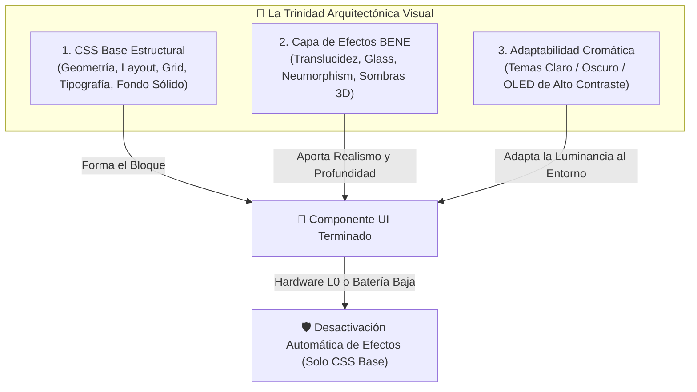

# 💎 Sistema de Diseño y Arquitectura Visual — B.U.C.A. AI
## Interfaz de Usuario, Tokens Dinámicos y Capas de Efectos

> **Ecosistema:** B.U.C.A. AI  
> **Identidad Visual:** *Corporate Hybrid Glass* evolucionando a *BENE Universal Design*  
> **Directiva Primaria:** `BNE-RULE-001` (Degradación L0 Eco Sólida)  
> **Estado:** `[Producción v1.1.8-alpha]` | `[Investigación v6.0.0]`

---

## 🌟 La Trinidad Arquitectónica del Diseño BENE

El sistema de diseño visual de B.U.C.A. AI se rige por una separación estricta de tres responsabilidades independientes:

1. **La Base Estructural (Forma el Bloque):** CSS/SCSS limpio, plano y sólido. Provee la estructura geométrica, espaciados y tipografía sin filtros costosos (`backdrop-filter: none`).
2. **La Capa de Efectos BENE (Aporta Realismo):** Se superpone declarativamente (`bne-effect="glassmorphic"`). Si el dispositivo carece de GPU o entra en pánico térmico, se apaga de golpe sin romper la interfaz.
3. **La Capa de Adaptabilidad Cromática (Adapta el Ambiente):** Define la relación de luminancia y contraste mediante `data-theme="light | dark"` o `bne-theme="oled"` para protección ocular y eficiencia energética.

---

## 📚 Mapa de Navegación del Sistema de Diseño

* **[📐 Arquitectura CSS Desacoplada y Trinidad BENE (`decoupled-css-architecture.md`)](file:///c:/wamp64/www/Clepces/projects/buca-ai/docs/ui/decoupled-css-architecture.md)**  
  Guía de refactorización hacia un CSS base limpio y desacoplado de los efectos visuales.
* **[🎨 Tokens Dinámicos, Variables y Jerarquía Z-Index (`design-tokens.md`)](file:///c:/wamp64/www/Clepces/projects/buca-ai/docs/ui/design-tokens.md)**  
  Escala tipográfica (14px base), paleta azul corporativo `#2563eb`, mixins SCSS y jerarquía vertical (Z-Index 1 a 99999).
* **[🪟 Catálogo Maestro de Componentes Nativos (`components-catalog.md`)](file:///c:/wamp64/www/Clepces/projects/buca-ai/docs/ui/components-catalog.md)**  
  Especificación de modales de sistema, ribbons de navegación, HUDs de telemetría y tarjetas comerciales.
* **[👁️ Accesibilidad Universal y Contraste Dinámico (`accessibility-wcag.md`)](file:///c:/wamp64/www/Clepces/projects/buca-ai/docs/ui/accessibility-wcag.md)**  
  Estándares WCAG AAA, soporte Safari `-webkit-user-select` y adaptación lumínica.
