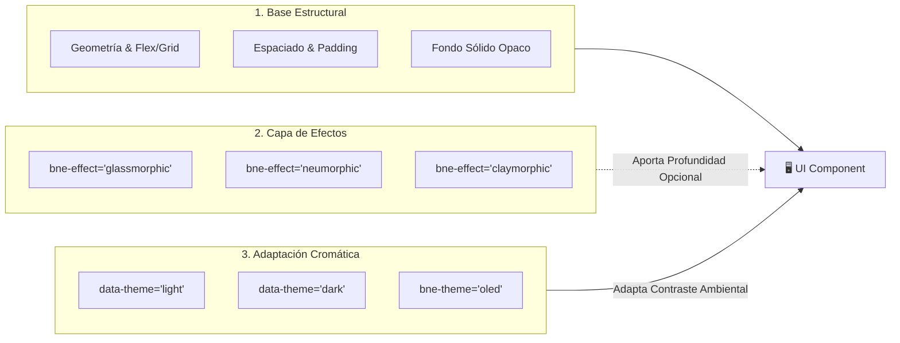

# 🧱 Arquitectura CSS Desacoplada y la Trinidad Visual BENE
## Refactorización Estructural: CSS Base Sólido, Capa de Efectos y Adaptación Cromática

> **Módulo:** `docs/ui/decoupled-css-architecture.md`  
> **Ecosistema:** B.U.C.A. AI  
> **Directiva de Evolución:** Transición de Estilos Acoplados (v5.3) a la Trinidad Desacoplada (v6.0)  
> **Estado:** `[Especificación de Ingeniería (new)]`

---

## 1. El Problema del CSS Acoplado Tradicional

En los sistemas visuales de cristal heredados, los estilos estructurales y los filtros de desenfoque estaban fuertemente fusionados en las mismas clases:

```scss
/* ❌ ENFOQUE LEGADO ACOPLADO (Riesgo de GPU Throttling) */
.buca-card {
    display: flex;
    padding: 18px;
    background: rgba(255, 255, 255, 0.7);
    border: 1px solid rgba(255, 255, 255, 0.2);
    backdrop-filter: blur(12px); /* Si el hardware es modesto, colapsa el layout */
}
```

Si el dispositivo entraba en ahorro de batería o poseía gráficos integrados débiles, eliminar el desenfoque requería sobreescrituras forzadas con `!important`, generando especificidad descontrolada y fragmentación del código.

---

## 2. La Solución BENE: La Trinidad del Diseño

La arquitectura visual de **B.U.C.A. AI** divide cada elemento de interfaz en tres capas conceptuales totalmente independientes:



### Capa 1: CSS Base Estructural (Forma el Bloque)
* **Propósito:** Provee la anatomía física, dimensiones (`width`, `height`), modelo de caja (`box-sizing`), alineación (`flex`, `grid`) y tipografía base.
* **Regla Inmutable:** **CERO FILTROS PESADOS.** El fondo base es siempre un color sólido opaco (`var(--surface-solid)`).
* **Beneficio:** Si la GPU se apaga por completo, el bloque sigue existiendo de manera estéticamente limpia, legible y ultra-rápida.

### Capa 2: Capa Modular de Efectos BENE (Aporta Realismo)
* **Propósito:** Aplica la textura y tridimensionalidad visual mediante atributos declarativos (`bne-effect="glassmorphic | neumorphic | claymorphic"`).
* **Regla Inmutable:** Toda propiedad de desenfoque (`backdrop-filter`) o sombra multicapa es condicional. Si la telemetría dicta `[bne-perf="L0"]`, la capa de efectos se disuelve instantáneamente, dejando expuesto el CSS Base sólido sin salto visual perceptible.

### Capa 3: Adaptación Cromática y Ambiental (Adapta al Entorno)
* **Propósito:** Sintoniza la paleta cromática con el contexto del usuario:
  - **Modo Claro (`data-theme="light"`):** Fondos claros de alta reflectancia para oficinas y luz diurna.
  - **Modo Oscuro (`data-theme="dark"`):** Superficies gris pizarra (`#0f172a`) con bordes luminiscentes sutiles para reducir la fatiga visual.
  - **Modo OLED (`bne-theme="oled"`):** Negros puros (`#000000`) para apagar físicamente los píxeles de pantallas AMOLED.

---

## 3. Implementación Canónica en SCSS Modular

```scss
// 1. BASE ESTRUCTURAL (Limpia y Sólida)
.buca-container-block {
    display: flex;
    flex-direction: column;
    padding: 18px;
    border-radius: 14px;
    box-sizing: border-box;
    background: var(--surface-solid);
    border: 1px solid var(--border-solid);
    color: var(--text-primary);
}

// 2. CAPA DE EFECTOS (Se activa solo si bne-effect está presente)
.buca-container-block[bne-effect="glassmorphic"] {
    background: var(--surface-glass);
    border-color: var(--border-glass);
    backdrop-filter: blur(calc(16px * var(--bne-fps-factor, 1)));
    -webkit-backdrop-filter: blur(calc(16px * var(--bne-fps-factor, 1)));
    box-shadow: 0 8px 32px rgba(0, 0, 0, calc(0.12 * var(--bne-shadow-factor, 1)));

    // DEGRADACIÓN AUTOMÁTICA EN PERFIL L0 (BENE-RULE-001)
    [bne-perf="L0"] & {
        background: var(--surface-solid) !important;
        backdrop-filter: none !important;
        -webkit-backdrop-filter: none !important;
        border-color: var(--border-solid) !important;
        box-shadow: 0 1px 3px rgba(0, 0, 0, 0.05) !important;
    }
}
```

> [!NOTE]
> `(new)` **Refactorización Continua:** Los archivos en `src/shared/styles/neural/` se migrarán gradualmente hacia este modelo de tres capas para asegurar que la suite visual opere con 0ms de tiempo de bloqueo en JavaScript.
