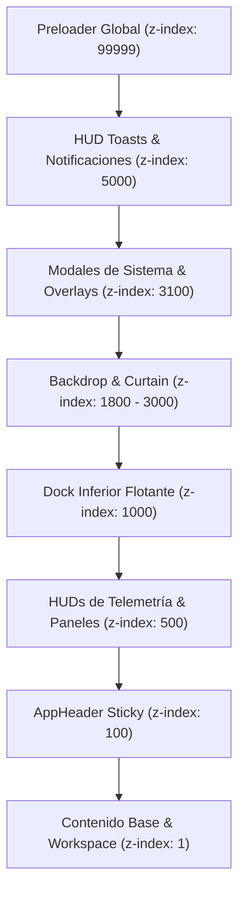

# 🎨 Tokens Dinámicos, Variables y Jerarquía Z-Index
## Especificación de Variables SCSS, Tipografía y Capas Verticales

> **Módulo:** `docs/ui/design-tokens.md`  
> **Archivos Fuente:** `src/shared/styles/neural/abstracts/_variables.scss`, `_mixins.scss`  
> **Estado:** `[Producción v1.1.8-alpha]`

---

## 1. Tokens de Color Corporativo

La paleta cromática se apoya en el **Azul Corporativo `#2563eb`** y variantes dinámicas:

| Token CSS | Modo Claro | Modo Oscuro | Propósito |
|---|---|---|---|
| `--primary-color` | `#2563eb` | `#3b82f6` | Color de marca primario y botones de acción. |
| `--surface-solid` | `#ffffff` | `#0f172a` | Fondo sólido de seguridad (Capa 1 Base / L0). |
| `--surface-glass` | `rgba(255, 255, 255, 0.72)` | `rgba(15, 23, 42, 0.82)` | Superficie translúcida con desenfoque dinámico. |
| `--border-solid` | `#e2e8f0` | `#1e293b` | Borde estructural para perfil L0. |
| `--border-glass` | `rgba(255, 255, 255, 0.35)` | `rgba(255, 255, 255, 0.08)` | Borde de cristal con brillo especular. |
| `--text-primary` | `#0f172a` | `#f8fafc` | Tipografía principal (alto contraste). |
| `--text-muted` | `#64748b` | `#94a3b8` | Metadatos, etiquetas y subtítulos. |

---

## 2. Tipografía y Densidad ERP

* **Fuente Primaria:** `Outfit`, `-apple-system`, `BlinkMacSystemFont`, `Segoe UI`, `sans-serif`.
* **Fuente Secundaria / Datos Numéricos:** `Inter` (diseñada para legibilidad tabular en balances y cotizaciones).
* **Tamaño Base:** `font-size: 14px` en escritorio para garantizar alta densidad de información contable sin generar fatiga visual.

---

## 3. Jerarquía Vertical Estandarizada (Z-Index)

Para evitar colisiones de apilamiento en la Single Page Application:



---

## 4. Regla de Oro BNE-RULE-001 en Mixins

```scss
@mixin buca-surface-glass {
    background: var(--surface-glass);
    border: 1px solid var(--border-glass);
    backdrop-filter: blur(var(--blur-intensity, 12px));
    -webkit-backdrop-filter: blur(var(--blur-intensity, 12px));

    [bne-perf="L0"] & {
        background: var(--surface-solid) !important;
        backdrop-filter: none !important;
        -webkit-backdrop-filter: none !important;
        border-color: var(--border-solid) !important;
    }
}
```
