# 🏛️ INFORME DE AUDITORÍA Y ARQUITECTURA DE MODALES — B.U.C.A. AI

**Fecha:** 26 de noviembre de 2026  
**Versión Analizada:** `1.1.24-alpha` (Bootstrap `^5.3.9` + Clean Core Vanilla JS)  
**Alcance:** `index.html` (`#modal-base`), `src/shared/ui/services/ModalService.js`, `src/core/services/KeyboardShortcuts.js`, `src/shared/ui/components/header/command-palette-modal.js`, `src/shared/ui/templates/ModalTemplates.js`, `src/shared/ui/templates/modals/_system_modals.js`, `src/shared/ui/layouts/components/ModalBase.js`, `src/shared/styles/neural/components/modals/` y los 15 consumidores activos.

---

## 1. Grafo de Corrección y Arquitectura (Antes → Actual → Nueva Generación)

```mermaid
flowchart TB
    subgraph ANTES["❌ ANTES (Acoplamiento Circular en shared/)"]
        A1["ModalTemplates.js (shared)"] -->|import estático 96KB+| A2["modules/profile/_user_profile.js"]
        A1 -->|import estático| A3["modules/finance/RateManagementModal.js"]
        A1 -->|import estático| A4["modules/business/business-wizard-template.js"]
        A1 -->|import estático| A5["modules/workspace/_performance.js"]
        A6["RateController / Telemetry / PerformanceModal"] -->|solo usaban buildHeader| A1
    end

    subgraph ACTUAL["✅ ESTADO ACTUAL (Clean Core Desacoplado)"]
        B1["index.html (#modal-base)"] --> B2["ModalService.js (slots + ScrollManager)"]
        B3["10 Modales de Módulos + 5 Globales"] -->|inyectan su propia plantilla| B2
        B2 -->|ActionDispatcher ui:close_modal| B1
        B4["ModalTemplates.js / ModalBase.js / _settings.js"] -.->|"0 importaciones externas (Código muerto)"| B2
    end

    subgraph NEXTGEN["🚀 NUEVA GENERACIÓN (Base Sólida .ui-modal + ModalServiceV2 + BENE v6)"]
        C1["index.html (#ui-modal-root)"] --> C2["src/shared/ui/modal/ (ModalServiceV2)"]
        C2 --> C2A["renderer + nav-controller + focus-trap + legacy-bridge"]
        C2A --> C3["Base Sólida (.ui-modal, __header, __body, __footer)"]
        C3 --> C4["Body: Skeleton | Empty/Error | nav-left/right/top (preserveState)"]
        C3 --> C5["Header Center Dual: Contexto (Stepper / Search) ↔ Alerta Global"]
        C3 --> C6["Header Right: IA + Ayuda + Tamaño [Experimental] (Drill-down Global) + X"]
        C8["Primitivas UI (ui-button + dom.js + ui-field)"] --> C3
        C9["Componentes Complejos (ResizeObserver + sticky toolbar)"] --> C4
        C3 -.->|"Opt-in futuro [bene-effect] + [bene-perf]"| C7["Motor BENE v6.x"]
    end
```



---

## 2. Auditoría del Estado Actual (Anomalías, Errores y Código Muerto)

### A. Código Muerto y Duplicado en `shared/`

> [!CAUTION]
> **Archivos con 0 consumidores o plantillas huérfanas**
> 1. **`src/shared/ui/templates/ModalTemplates.js`**: 0 importaciones en `src/` o `tests/`.
> 2. **`src/shared/ui/layouts/components/ModalBase.js`**: 0 importaciones; duplica el HTML de `#modal-base` en `index.html`.
> 3. **`src/shared/ui/templates/modals/_settings.js`**: únicamente lo referenciaba `ModalTemplates.js`.
> 4. **`src/shared/ui/templates/modals/_system_modals.js`**: contiene 5 plantillas (`terminalTemplate`, `helpTemplate`, `alertMiniTemplate`, `notificationsTemplate`, `comingSoonTemplate`). Solo `terminalTemplate` se usa desde `audit-terminal-modal.js`; las otras 4 son legado sin consumidor o acopladas a `.glass-surface` / `animate__animated`.

### B. Bugs, Fugas y Anomalías Detectadas en Código Activo

> [!CAUTION]
> **Errores Reales de Ejecución, Teclado y DOM**
> 1. **Doble ejecución al cerrar (`ModalService.js` L132–137):** `ModalService.init()` escucha `ui:close_modal` y `showModal()` vuelve a registrar `$on(btn, 'click', () => this.hideModal())` sobre `[data-action="ui:close_modal"]`. Un clic ejecuta `hideModal()` **dos veces**.
> 2. **Doble listener y conflicto de prioridad en `Escape` (`KeyboardShortcuts.js` L15–20 vs `ModalService.js` L55–62):** ambos escuchan `Escape` globalmente. Además, si un **Drill-down Menu** o dropdown está abierto dentro del modal, `Escape` cerraría el modal completo en vez de cerrar primero el menú desplegable.
> 3. **`Ctrl/Cmd + K` sin guardia de contexto (`KeyboardShortcuts.js` L23–26):** abre `CommandPaletteModal` incluso si hay un modal crítico abierto (ej. `MFAEnrollmentModal` o un wizard con cambios sin guardar), reemplazándolo y destruyendo su estado.
> 4. **Buscador `CommandPaletteModal` sin navegación por teclado real (`command-palette-modal.js` L66, L141–181):**
>    - El footer muestra `<kbd>↑</kbd> <kbd>↓</kbd> para navegar`, pero **`_bindEvents()` NO implementa `keydown`** (`ArrowUp`, `ArrowDown`, `ArrowLeft`, `ArrowRight`, `Enter`).
>    - Los ítems en vista **Lista** (`.cmd-item-row`) y **Cuadrícula/Mosaico** (`.cmd-item-card`) son `<div>` sin `tabindex`, sin `role="option"` y sin `aria-selected`.
>    - Usa `results.innerHTML = ...` directo (L152, L166, L178) en lugar de `$mount()` seguro.
> 5. **Timer huérfano y ausencia de `AbortController` (`ModalService.js` L159–175):** `setTimeout(..., 180)` no guarda ID cancelable ni aborta listeners/peticiones pendientes de la plantilla al cerrar.
> 6. **Carencias WCAG (A11y) e IxD:** `#modal-base` carece de `role="dialog"`, `aria-modal="true"`, `aria-labelledby`, *Focus Trap* (`Tab`/`Shift+Tab`) y restauración de foco al disparador al cerrar.

### C. Anomalías en SCSS Legacy (`_modals-shell.scss`) y Colisión con Bootstrap v5.3.9

> [!WARNING]
> **Problemas en `src/shared/styles/neural/components/modals/_modals-shell.scss`**
> - **Uso abusivo de `!important`:** más de 15 declaraciones `!important` para pelear con `.modal-header`, `.modal-body` y `.modal-footer` de Bootstrap 5 (`bootstrap@^5.3.9`).
> - **`transition: all 0.35s` y `transition: all 0.4s` (L25, L106):** animar `all` fuerza recálculos innecesarios de layout/paint en lugar de animar solo `opacity` y `transform`.
> - **Selector legacy `[data-buca-perf="L0"]` (L30, L94):** no contempla `[bne-perf="L0"]`.
> - **Acoplamiento `#perf-modal-overlay` (L16–18):** un ID específico de módulo incrustado en el shell global de `shared/`.
> - **Corrección de nomenclatura (`.buca-*` → `.ui-modal*`):** usar **`.ui-modal`** elimina la marca del CSS, evita colisiones con Bootstrap 5 y mantiene coherencia con `ui:close_modal`.

---

## 3. Declaración Canónica de Estructura Hueca HTML, Clases, Atributos e IDs

> [!NOTE]
> **Principio de Diseño Base Sólido:** Una única estructura hueca en `index.html` (`#ui-modal-root`), sin `backdrop-filter` por defecto, usando `var(--surface-solid)` y `var(--border-subtle)`, y compatible con utilidades Bootstrap v5 (`row`, `col-*`, `alert`, `accordion`) dentro de `.ui-modal__content`.

```html
<!-- SHELL GLOBAL DE MODAL (NUEVA GENERACIÓN - BASE SÓLIDA) -->
<div
  id="ui-modal-root"
  class="ui-modal-backdrop"
  aria-hidden="true"
  data-modal-state="closed"
  data-modal-scope="global"
>
  <section
    id="ui-modal-dialog"
    class="ui-modal"
    role="dialog"
    aria-modal="true"
    aria-labelledby="ui-modal-title"
    aria-describedby="ui-modal-subtitle"
    data-modal-size="md"
    data-modal-layout="plain"
    tabindex="-1"
  >
    <!-- 1. HEADER (3 ZONAS: LEFT | CENTER | RIGHT) -->
    <header class="ui-modal__header" id="ui-modal-header">
      <!-- 1A. LEFT: Icono + Título + Subtítulo + Badge opcional -->
      <div class="ui-modal__header-left" id="ui-modal-header-left">
        <span class="ui-modal__icon" id="ui-modal-icon" aria-hidden="true"></span>
        <div class="ui-modal__heading">
          <div class="ui-modal__title-row">
            <h2 class="ui-modal__title" id="ui-modal-title"></h2>
            <span class="ui-modal__badge" id="ui-modal-badge" hidden></span>
          </div>
          <p class="ui-modal__subtitle" id="ui-modal-subtitle" hidden></p>
        </div>
      </div>

      <!-- 1B. CENTER: Slot contextual (ej. Stepper Wizard) + Alerta Global intercambiable -->
      <div class="ui-modal__header-center" id="ui-modal-header-center">
        <div class="ui-modal__header-context" id="ui-modal-header-context"></div>
        <div
          class="ui-modal__header-alert"
          id="ui-modal-header-alert"
          role="status"
          aria-live="polite"
          data-alert-type="warning"
          hidden
        ></div>
      </div>

      <!-- 1C. RIGHT: Acciones de plantilla + Acciones Globales por defecto -->
      <div class="ui-modal__header-right" id="ui-modal-header-right">
        <div class="ui-modal__header-actions" id="ui-modal-header-actions"></div>

        <div class="ui-modal__global-controls" id="ui-modal-global-controls">
          <button
            type="button"
            class="ui-modal__icon-btn"
            id="ui-modal-btn-ai"
            data-action="ui:modal_ai_assist"
            aria-label="Asistente de Inteligencia Artificial"
            title="Asistente IA"
          ></button>

          <button
            type="button"
            class="ui-modal__icon-btn"
            id="ui-modal-btn-help"
            data-action="ui:modal_help"
            aria-label="Ayuda del módulo"
            title="Ayuda"
          ></button>

          <button
            type="button"
            class="ui-modal__icon-btn ui-modal__icon-btn--experimental"
            id="ui-modal-btn-resize"
            data-action="ui:modal_size_menu"
            data-badge="Experimental"
            aria-haspopup="menu"
            aria-expanded="false"
            aria-label="Tamaño de ventana (Experimental)"
            title="Tamaño de ventana (Experimental)"
          ></button>

          <button
            type="button"
            class="ui-modal__close-btn"
            id="ui-modal-btn-close"
            data-action="ui:close_modal"
            aria-label="Cerrar ventana"
            title="Cerrar (Esc)"
          ></button>
        </div>
      </div>
    </header>

    <!-- 2. BODY (CONTENEDOR DE PLANTILLA: SKELETON + NAV OPCIONAL + CONTENT) -->
    <div class="ui-modal__body" id="ui-modal-body" data-loading="false">
      <div class="ui-modal__skeleton" id="ui-modal-skeleton" aria-hidden="true" hidden></div>

      <aside
        class="ui-modal__nav"
        id="ui-modal-nav"
        data-nav-position="left"
        data-nav-collapsed="false"
        hidden
      ></aside>

      <!-- REGLA: Prohibido renderizar botones de submit/acción principal aquí; pertenecen al footer -->
      <main class="ui-modal__content" id="ui-modal-content"></main>
    </div>

    <!-- 3. FOOTER (3 ZONAS: LEFT | CENTER | RIGHT — Por vista o global) -->
    <footer class="ui-modal__footer" id="ui-modal-footer" data-footer-scope="view">
      <div class="ui-modal__footer-left" id="ui-modal-footer-left"></div>
      <div class="ui-modal__footer-center" id="ui-modal-footer-center"></div>
      <div class="ui-modal__footer-right" id="ui-modal-footer-right"></div>
    </footer>
  </section>
</div>
```

---

## 4. Contrato JS de `ModalService.showModal(...)` (Estructura `header` por Zonas)

> [!TIP]
> **Confirmación de API propuesta por el usuario:** Sí, estructurar `header` directamente con las 3 zonas `{ left, center, right }` es más limpio, predecible y fiel al DOM que aplanar campos en la raíz. Además permite un puente de compatibilidad directo: si `header.left` es un objeto, hidrata los slots estructurados; si es un `string` legacy, lo monta de forma segura mientras se migran los 15 consumidores.

```js
ModalServiceV2.showModal({
  id: 'business-wizard',       // Clave única (evita duplicados con isOpen(id))
  scope: 'module',             // 'global' | 'module'
  size: 'md',                  // 'xs' | 'sm' | 'md' | 'lg' | 'xl' | 'full'
  layout: 'plain',             // 'plain' | 'nav-left' | 'nav-right' | 'nav-top'
  mobileMode: 'sheet',         // 'sheet' | 'fullscreen' | 'dialog'
  loading: false,              // true activa #ui-modal-skeleton hasta resolver onOpen
  closeOnBackdrop: true,       // false en flujos críticos (ej. MFA, wizards)
  closeOnEsc: true,            // false si requiere confirmación explícita
  closeOnRouteChange: true,    // cierra limpio al emitir router:navigate / auth:logout
  lockShortcuts: false,        // true bloquea Ctrl+K mientras esté abierto
  stackMode: 'replace',        // 'replace' | 'queue' | 'stack'
  initialFocus: null,          // selector CSS (ej. '#cmd-palette-input') o null (primer enfocable)
  header: {
    left: {
      icon: 'bi-building',
      title: 'Título del Modal',
      subtitle: 'Subtítulo descriptivo opcional',
      badge: { text: 'v2', tone: 'info' } // opcional
    },
    center: {
      html: '' // o componente contextual (ej. Stepper Wizard)
    },
    right: {
      actions: [], // botones o disparadores de Drill-down Menu
      showGlobalControls: { ai: true, help: true, resize: true }
    }
  },
  body: {
    nav: null,     // items de barra lateral o tabs cuando layout != 'plain'
    views: null,   // mapa/lista de vistas { id, label, icon, badge, render, footer }
    activeView: null,
    html: ''       // contenido estático/dinámico (sin botones de submit)
  },
  footer: {
    scope: 'view', // 'view' | 'global'
    left: '',
    center: '',
    right: ''
  },
  onViewChange: ({ viewId, signal }) => {},
  beforeClose: ({ reason }) => true, // boolean | Promise<boolean> ('close-btn' | 'esc' | 'backdrop' | 'route-change' | 'programmatic')
  onOpen: ({ modalEl, contentEl, signal, setLoading, setFooter, notifyHeader, setView, close }) => {},
  onClose: ({ reason }) => {}
});
```

---

## 5. Estrategia de Teclado, Buscador (Lista / Cuadrícula) y Drill-down Menu

### 5.1. Jerarquía Única de `Escape` y Atajos Globales (`KeyboardShortcuts.js`)
1. **Capa 1 (Prioridad máxima):** Si existe un **Drill-down Menu** o dropdown abierto dentro del modal, `Escape` cierra **solo el menú** y devuelve el foco al botón disparador.
2. **Capa 2:** Si no hay submenú abierto y existe un panel de header abierto, lo cierra.
3. **Capa 3:** Si hay un modal abierto, `Escape` ejecuta `ModalService.requestClose()` (que respeta `beforeClose` si hay cambios sin guardar).
4. **Guardia `Ctrl/Cmd + K`:** si hay un modal crítico abierto (ej. `MFAEnrollmentModal` o modal con `lockShortcuts: true`), `Ctrl+K` no destruye el modal activo.

### 5.2. Mejora UX/IxD del Buscador (`CommandPaletteModal` — Lista y Cuadrícula)
> [!TIP]
> **Rediseño Visual y Navegación por Teclado Real (`role="listbox"` / `role="grid"`):**
> - **Header 3 Zonas aplicado al Buscador:**
>   - `header.left`: icono + título (`Paleta de Comandos`) + subtítulo descriptivo + badge opcional.
>   - `header.center`: **`<input type="search">` integrado en el centro del header** (libera espacio vertical en el body y mantiene la búsqueda fija al hacer scroll).
>   - `header.right`: **selector Lista / Mosaico** ubicado en `.ui-modal__header-actions` junto al resto de acciones y controles globales (el botón `Cerrar` puede vivir en header o footer según estética de la vista).
> - **Estrategia UI Viva vs UI Muerta (`status: 'in-dev'`):** los ítems en desarrollo o no implementados se renderizan con **escala de grises + estado `disabled`** (sin disparar acciones rotas) y **badge `En desarrollo` con tooltip informativo** para distinguir visualmente lo operativo de lo planificado.
> - **Navegación por Teclado Real:**
>   - **Vista Lista:** `ArrowDown` / `ArrowUp` mueven `aria-selected="true"` entre `.cmd-item-row` visibles con `scrollIntoView({ block: 'nearest', behavior: 'smooth' })`.
>   - **Vista Cuadrícula (Mosaico):** `ArrowRight` / `ArrowLeft` avanzan/retroceden por columna y `ArrowDown` / `ArrowUp` saltan por fila según el ancho del grid.
>   - **Ejecución y Switch:** `Enter` ejecuta el ítem activo; `Ctrl/Cmd + Shift + L` alterna Lista/Cuadrícula conservando la selección; renderizado con `$mount()` en vez de `innerHTML`.

### 5.3. Drill-down Menu Global (`src/shared/ui/components/drilldown-menu/`)
- Componente transversal reutilizable en toda la app (modales, header, tablas y tarjetas).
- Ítems con anatomía `[icono] + [texto] + [icono chevron]`, navegación multinivel con botón `Volver`, soporte de teclado (`ArrowUp`, `ArrowDown`, `ArrowRight`, `ArrowLeft`, `Enter`, `Escape`) y auto-posicionamiento dentro del viewport.

### 5.4. Estabilidad Dimensional del Modal y Flexibilidad del Footer
> [!IMPORTANT]
> **Regla de Caja Fija (Cero Redimensionamiento por Contenido del Body):**
> - **El contenido del `body` NUNCA redimensiona la caja `.ui-modal`:** cada talla (`data-modal-size="xs|sm|md|lg|xl|full"`) define dimensiones estables (`width` y `height` / `min-height` consistentes dentro de `min(88dvh, 860px)`).
> - Si un modal tiene **múltiples pestañas** (una con 3 líneas y otra con 40 campos) o un **buscador que filtra a 0–2 resultados**, la ventana **mantiene su tamaño estable** sin encogerse ni saltar.
> - `.ui-modal__body` usa `flex: 1 1 auto; min-height: 0; overflow: hidden;` y `.ui-modal__content` gestiona el scroll interno con `overflow-y: auto; scrollbar-gutter: stable;` para evitar saltos horizontales al aparecer/desaparecer la barra de scroll.
> - **Flexibilidad del `footer` (`left`, `center`, `right`):** admite libremente texto informativo (ej. hints de teclado `↑ ↓ ESC` o estado de sesión), iconos, badges y botones de acción, siempre respetando la regla de que las acciones `Submit` viven aquí y nunca dentro del `body`.

---

## 6. Cómo Trataremos `index.html`, los Archivos Legacy y Qué Precauciones Tomar

### 6.1. Plan para `index.html`
> [!IMPORTANT]
> **Tratamiento Quirúrgico de `index.html` (L212–227):**
> - No eliminaremos `#modal-base` de golpe mientras haya código apuntando a él.
> - **Paso limpio:** reemplazaremos el bloque `#modal-base` (L212–227) por `#ui-modal-root` **en el mismo commit** en que `ModalService.js` active su puente de compatibilidad (`header.left` string → `#ui-modal-header-left`, `body` string → `#ui-modal-content`, etc.) y actualicemos `_ui-modal.scss`.
> - Validaremos `index.html` con `markuplint` (ya presente en `package.json`) para garantizar HTML5 y ARIA 100% válidos.

### 6.2. Plan para Archivos Legacy
- **`ModalTemplates.js`, `ModalBase.js`, `modals/_settings.js`:** eliminar cuando `#ui-modal-root` esté validado en pruebas y build.
- **`src/shared/ui/templates/modals/_system_modals.js`:** mover `terminalTemplate` junto a `audit-terminal-modal.js` (único consumidor) y eliminar las 4 plantillas huérfanas (`helpTemplate`, `alertMiniTemplate`, `notificationsTemplate`, `comingSoonTemplate`) o reescribir `helpTemplate` como módulo limpio para `#ui-modal-btn-help`.
- **`src/shared/styles/neural/components/modals/*.scss`:** sustituir progresivamente las reglas `.glass-modal*` y `.modal-*` (con `!important`) por `_ui-modal.scss` usando tokens sólidos (`var(--surface-solid)`, `var(--border-subtle)`).
- **`src/modules/workspace/styles/_performance_modal.scss` y `src/modules/finance/styles/rate-modal/`:** revisar que no dependan de `#modal-base` o `.glass-modal` tras el cambio de shell.

### 6.3. Precauciones Críticas y Brechas de App Detectadas
> [!WARNING]
> **De qué debemos estar precavidos durante la implementación:**
> 1. **Cierre automático en navegación (`router:navigate`) y `auth:logout`:** `ModalService` actual no escucha cambios de ruta ni cierre de sesión; si el usuario navega desde `CommandPaletteModal` o usa `Atrás` del navegador, el modal podría quedar huérfano o `ScrollManager` bloqueado. `ModalServiceV2` debe cerrar limpio con `reason: 'route-change'`.
> 2. **Coordinación con `tooltip-service.js` y `FloatingPanelManager.js`:** al abrir un modal, `FloatingPanelManager` debe cerrar paneles abiertos (`header:close_all_panels`), y `tooltip-service.js` debe tener `z-index` superior al modal para mostrar los tooltips de `Experimental` y `En desarrollo`.
> 3. **Evento `ui:open_modal` (`ModalService.js` L31–40):** mantener soporte sanitizado en `ModalServiceV2` para llamadas genéricas vía `EventBus`.
> 4. **Atributo `inert` en `#app`:** aplicar `inert` al contenedor `#app` mientras `#ui-modal-root` esté abierto para bloquear clics, foco y lectores de pantalla fuera del modal sin depender de `pointer-events: none` por CSS.
> 5. **Eventos de formulario con `footer` separado:** al mover botones `Submit` al `#ui-modal-footer`, usar `form="id-del-form"` y verificar que `ActionDispatcher` no intercepte ni duplique el `submit` nativo.
> 6. **Scroll y móviles (`dvh`):** probar teclados virtuales en móvil para que `max-height: 88dvh` no corte el footer al escribir en inputs dentro del modal.
> 7. **Tests unitarios y linters:** ejecutar `npm test`, `npm run lint:js`, `npm run lint:css`, `npm run type-check` y `npm run build` tras cada fase de migración.

### 6.4. Arquitectura Modular `ModalServiceV2` (Límite de 300 Líneas y `kebab-case`)
> [!NOTE]
> **Decisión Arquitectónica (Solución a la regla de 300 líneas de `architect.md`):**
> En lugar de sobrecargar `ModalService.js` (226 líneas actuales), se crea el paquete modular **`src/shared/ui/modal/`** en estricto `kebab-case` (ej. `modal-service-v2.js`, no `ModalService.v2.js`), con clase `ModalServiceV2` (`constructor`, `init`, gestión de recursos, `AbortController` y `destroy`):
> - `src/shared/ui/modal/modal-service-v2.js` (~160 líneas): Orquestador principal (`class ModalServiceV2`), constructor, ciclo de vida, pila/guardias (`closeOnBackdrop`, `closeOnEsc`, `lockShortcuts`, `beforeClose`) y limpieza total.
> - `src/shared/ui/modal/modal-renderer.js` (~140 líneas): Hidratación de slots (`header` 3 zonas, `body`, `footer` 3 zonas), skeleton de precarga y alertas animadas en `header-center`.
> - `src/shared/ui/modal/modal-nav-controller.js` (~110 líneas): Lógica de `nav-left`, `nav-right` colapsable, `nav-top` (tabs) y actualización de `footer` por vista.
> - `src/shared/ui/modal/modal-focus-trap.js` (~90 líneas): Focus Trap (`Tab`/`Shift+Tab`), `initialFocus`, `inert` sobre `#app` y restauración de foco al cerrar.
> - `src/shared/ui/modal/modal-legacy-bridge.js` (~80 líneas): Adaptador temporal para llamadas antiguas (`header: { left: string }`, `body: string`), eliminable al concluir la Fase 3.
> - `src/shared/ui/services/ModalService.js`: Fachada temporal que delega en `ModalServiceV2` para garantizar cero ruptura en los 15 consumidores durante la transición.

---

## 7. Inventario Completo de Modales Legacy, Estado de Migración y Compatibilidad

### 7.1. Modales Activos (`showModal` — 5 Globales + 10 de Módulos)

| Fase | Ámbito | Archivo / Consumidor | Estado | Compatibilidad v2 | Ajustes Requeridos |
| :---: | :--- | :--- | :---: | :---: | :--- |
| **1** | Global (`shared`) | `shared-actions.js` (L51 — Features) | 🔴 No migrado | 🟢 Compatible vía puente | Pasar `header.left` a objeto `{ icon, title, subtitle }` |
| **1** | Global (`shared`) | `shared-actions.js` (L59 — Changelog) | 🔴 No migrado | 🟢 Compatible vía puente | Pasar `header.left` a objeto `{ icon, title, subtitle }` |
| **1** | Global (`shared`) | `ai-copilot-modal.js` (L17) | 🔴 No migrado | 🟡 Compatible con ajustes | Reemplazar `innerHTML` por `$mount()`; enlazar con `#ui-modal-btn-ai` |
| **1** | Global (`shared`) | `audit-terminal-modal.js` (L19) | 🔴 No migrado | 🟡 Compatible con ajustes | Mover `terminalTemplate` fuera de `_system_modals.js`; quitar `.glass-surface` |
| **1** | Global (`shared`) | `command-palette-modal.js` (L61) | 🔴 No migrado | 🟡 Compatible con ajustes | Input a `header.center`; switch Lista/Mosaico a `header.right`; teclado `↑↓←→` + `Enter`; escala de grises/`disabled` en `in-dev`; `$mount()` |
| **2** | Módulo `auth` | `src/modules/auth/index.js` (L191) | 🔴 No migrado | 🟢 Compatible vía puente | Migrar `header.left` a objeto y validar `closeOnBackdrop` |
| **2** | Módulo `business` | `business-wizard-modal.js` (L12) | 🔴 No migrado | 🟡 Compatible con ajustes | Mover stepper a `header.center` + alertas globales; botones de paso al `footer` |
| **2** | Módulo `business` | `BusinessHub.js` (L247) | 🔴 No migrado | 🟡 Compatible con ajustes | Eliminar clases `.glass-*` internas del body |
| **2** | Módulo `finance` | `RateController.js` (L59, L114) | 🔴 No migrado | 🟠 Requiere ajuste directo | **L114 referencia `#modal-body-content` directo**; migrar a `onOpen({ contentEl })` y `form="id"` en footer |
| **2** | Módulo `profile` | `MFAEnrollmentModal.js` (L35) | 🔴 No migrado | 🟠 Requiere ajuste directo | Activar `lockShortcuts: true`, `closeOnBackdrop: false`; quitar `.glass-*` y mover `submit` al `footer` |
| **2** | Módulo `profile` | `profile-modal.js` (L30) | 🔴 No migrado | 🟡 Compatible con ajustes | Adaptar secciones a `layout: 'nav-left'` / `'nav-top'` |
| **3** | Módulo `workspace` | `PerformanceModal.js` (L48) | 🔴 No migrado | 🟡 Compatible con ajustes | Migrar pestañas a `body.views` y estilos fuera de `.glass-modal` |
| **3** | Módulo `workspace` | `TelemetryComponent.js` (L156) | 🔴 No migrado | 🟡 Compatible con ajustes | Usar `signal` (`AbortController`) en timers/listeners y quitar `.glass-*` |
| **3** | Módulo `workspace` | `export-report-modal.js` (L11) | 🔴 No migrado | 🟢 Compatible vía puente | Pasar `header.left` a objeto y acciones al `footer` |
| **3** | Módulo `sandbox` | `SandboxController.js` (L12) | 🔴 No migrado | 🟢 Compatible vía puente | Migrar `header.left` a objeto v2 |

### 7.2. Archivos, Plantillas y Estilos Legacy de Soporte

| Archivo Legacy | Tipo | Estado | Compatibilidad v2 | Acción Planificada |
| :--- | :--- | :---: | :---: | :--- |
| `index.html` (L212–227 `#modal-base`) | Shell HTML | 🔴 Legacy activo | 🔴 Incompatible directo | Reemplazar por `#ui-modal-root` junto con puente en `ModalService.js` |
| `src/shared/ui/services/ModalService.js` | Servicio | 🔴 Legacy activo | 🟡 Puente temporal | Convertir en fachada de `ModalServiceV2` hasta cerrar Fase 3 |
| `src/shared/ui/templates/ModalTemplates.js` | Plantillas | ⚫ Código muerto (0 usos) | 🔴 Incompatible | Eliminar tras validar Fase 1 |
| `src/shared/ui/layouts/components/ModalBase.js` | Shell duplicado | ⚫ Código muerto (0 usos) | 🔴 Incompatible | Eliminar tras validar Fase 1 |
| `src/shared/ui/templates/modals/_settings.js` | Plantillas | ⚫ Código muerto (0 usos) | 🔴 Incompatible | Eliminar tras validar Fase 1 |
| `src/shared/ui/templates/modals/_system_modals.js` | Plantillas | 🟡 Parcial (1/5 en uso) | 🔴 Incompatible | Extraer `terminalTemplate` a `audit/` y eliminar el resto |
| `src/shared/styles/neural/components/modals/_modals-*.scss` | SCSS (5 archivos) | 🔴 Legacy activo | 🔴 Colisión Bootstrap | Sustituir progresivamente por `_ui-modal.scss` sólido sin `!important` |
| `src/modules/workspace/styles/performance-modal/_perf-shell.scss` (L219) | SCSS Módulo | 🔴 Legacy activo | 🟡 Compatible con ajustes | Actualizar selector `#modal-base` / `.glass-modal` a `.ui-modal` |
| `src/shared/styles/neural/base/_global.scss` (L127, L150) | SCSS Global | 🔴 Legacy activo | 🟡 Compatible con ajustes | Actualizar referencias `.glass-modal` / `#modal-base` |
| `src/core/storage/PerformanceStorage.js` (L128) | Storage Core | 🔴 Legacy activo | 🟡 Compatible con ajustes | Revisar referencia a `modal-base` / selector legacy y desacoplar |

---

## 8. Primitivas UI (Botones e Inputs) y Soporte para Componentes Complejos

### 8.1. Creador de Botones (`src/shared/ui/primitives/ui-button.js`) — Reutilización y Seguridad
> [!TIP]
> **Recomendación: SÍ crear `renderButton(...)` / `createButton(...)`, reutilizando CSS y utilidades existentes:**
> - **Reutilización CSS sin duplicar:** aprovechar las clases ya existentes en `src/shared/styles/neural/` (`.btn-primary`, `.btn-success`, `.btn-warning`, `.btn-danger`, `.btn-ghost`, `.btn-outline`, `.badge`, `.badge--*`) y consolidar las definiciones repetidas de `.btn-primary` / `.btn-ghost` (hoy duplicadas entre `_elements.scss`, `_buttons.scss` y `_modals-footer.scss`).
> - **Reutilización JS:** `src/shared/utils/dom.js` ya provee **`setButtonLoading`** y **`setButtonContent`**. `ui-button.js` genera el HTML seguro (`escapeHTML`) para las 4 variantes (**solo texto**, **solo icono**, **icono + texto**, **icono + texto + icono**) y delega estados de carga/contenido en esos helpers.
> - **Prevención de desbordamiento y colapsos:**
>   - `.ui-btn` con `display: inline-flex; align-items: center; justify-content: center; gap: 0.5rem; white-space: nowrap; flex-shrink: 0; max-width: 100%;`.
>   - `.ui-btn__label` con `min-width: 0; overflow: hidden; text-overflow: ellipsis;`.
>   - En `.ui-modal__footer` y `.ui-modal__header-actions`, usar `flex-wrap: wrap; gap: 0.5rem;` para adaptarse sin desbordar en móvil.

### 8.2. Creador de Inputs y Campos (`src/shared/ui/primitives/ui-field.js`) — Anatomía Completa
> [!WARNING]
> **Estrategia de Cero Ruptura (CSS existente + Bootstrap `^5.3.9` + Rendimiento):**
> - **Anatomía declarativa del campo:**
>   `[label + required/optional]` → **`.ui-field-box` (`[icono] + [input/select/textarea con placeholder] + [combinación de tecla .cmd-kbd | badge .badge | botón toggle]`)** → `[hint / error-slot con aria-describedby]`.
> - **Reutilización de CSS existente:** envuelve `.form-control` / `.form-select` de Bootstrap 5, `.cmd-kbd` (`_solid-panels.scss`) y `.badge` / `.badge--*` (`_elements.scss` / `_badges.scss`), refinando solo los ajustes de espaciado y borde dentro de `.ui-field-box` (sin `!important` ni estilos duplicados).
> - **Cero desbordamiento ni colapso en Flex/Grid:**
>   - `.ui-field`: `display: flex; flex-direction: column; gap: 0.35rem; min-width: 0; width: 100%;`
>   - `.ui-field-box`: `display: flex; align-items: center; gap: 0.5rem; width: 100%; min-width: 0; box-sizing: border-box;`
>   - Input interno: `flex: 1 1 auto; min-width: 0; width: 100%;` y los adornos (`icono`, `.cmd-kbd`, `.badge`) con `flex-shrink: 0; white-space: nowrap;` para que nunca aplasten el placeholder ni rompan columnas (`row`/`col-*`).
> - **Cero fugas, cero lentitud y linters limpios:** funciones puras de renderizado con `escapeHTML()` (montaje vía `$mount()`), sin listeners globales por input (eventos delegados o atados al `signal` de `AbortController` del modal), cumpliendo `eslint`, `stylelint`, `tsc` y `markuplint`.

### 8.3. Qué le Faltaba al Servicio y UI/UX/IxD para Soportar Componentes Complejos
> [!IMPORTANT]
> **5 Capacidades Clave para Modales Complejos (`PerformanceModal`, `TelemetryComponent`, `BusinessWizard`, `AICopilot`):**
> 1. **`ResizeObserver` + Hook `onResize`:** cuando el usuario cambia el tamaño del modal con el selector `Experimental` o colapsa `.ui-modal__nav`, componentes como **D3.js** o `<canvas>` necesitan recalcular dimensiones. `ModalServiceV2` debe observar `.ui-modal__content` y notificar a la vista activa.
> 2. **Preservación de estado entre pestañas (`preserveState: true`):** en modales multipaso o con múltiples tabs (`body.views`), cambiar de pestaña no debe destruir formularios rellenados ni gráficas renderizadas; `modal-nav-controller.js` ocultará paneles inactivos con `hidden` + `inert` en lugar de borrar el DOM.
> 3. **Estados estándar `Empty` y `Error + Reintentar` (`setError` / `setEmpty`):** además del `Skeleton` (`loading: true`), un componente complejo conectado a Supabase puede fallar o venir vacío; el servicio debe ofrecer estados visuales unificados sin que cada módulo invente el suyo.
> 4. **Toolbar Sticky opcional (`.ui-modal__toolbar`):** para tablas extensas, logs (`audit-terminal-modal`) o filtros de telemetría, una barra sticky superior dentro de `.ui-modal__content` mantiene los filtros visibles durante el scroll.
> 5. **Confirmación inline en Footer (anti-doble-modal):** para acciones destructivas dentro de un modal complejo, permitir confirmación en dos pasos dentro del propio `#ui-modal-footer` sin apilar otro modal encima.
